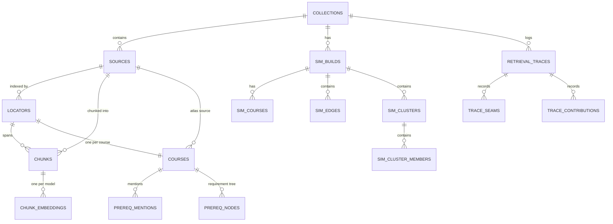
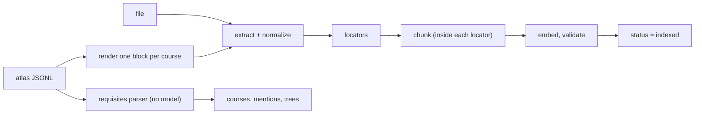
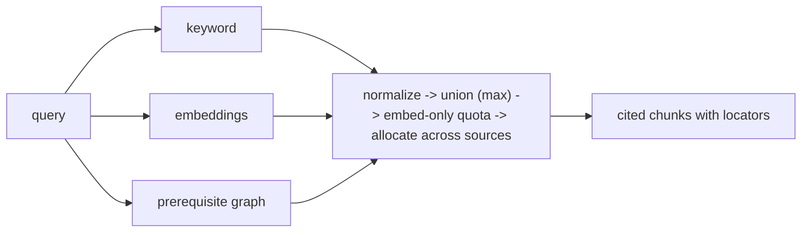
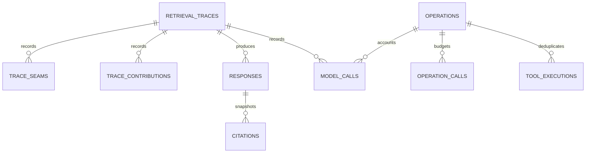

# Architecture: Emory STEM Advisor

This is the single design doc for the project. It is the contract: code and
the frontend API types must match it. It folds in what used to be three files
(`architecture.md`, the data-layer build plan, and the Stacks reference); where
those conflicted, this document reflects the system as actually built. Sections
explicitly marked planned describe the requested next implementation, not
completed behavior. Archived references are evidence, never another contract.

The primary goal is accuracy: institutional advice must be grounded in the
internal docs, and the system must be able to show why each claim is believed.
The artifact tools may also use user-supplied documents/data, with that
provenance distinguished from authoritative institutional material.

The data layer has four parts:

| Layer | Job | Built from |
| --- | --- | --- |
| Keyword | Find chunks that use the query's words | Postgres full-text search |
| Embeddings | Find chunks that mean the same thing in other words | Embedding model, pgvector |
| Prerequisite graph | What a course requires and what it unlocks | Parsed **deterministically** from Emory's course atlas. **An LLM never writes it** |
| Similarity graph | Course recommendations and visuals | Clustering of course embeddings, plus hand-written nudges |

The first three are retrieval seams that feed one fusion and citation
contract. The similarity graph is separate: fixed departments contain learned
topic groups and their courses. There is no TOC layer.

## Provenance: this grew out of Stacks

Stacks is an earlier project by the same author (a local-first, single-user
study tool; separate private repository). Much of this design grew out of it.
**Stacks is a reference, not a template.** The two projects do not map 1:1
because the layers do not behave the same.

Additional source snapshots were supplied on 2026-10-07. The architecture
table below describes the historical lineage; the latest Stacks
system is a local desktop app and has superseded some older log decisions.
Instructions and completion labels in those documents do not govern this repo.
Appendix A records the adopted reliability lessons.

Rules:

1. Nothing from Stacks is adopted by default. Only items listed below as
   **Keep** or **Adapt** apply. Anything unlisted is not part of this project.
2. Stacks code, schemas, configs, and names are not copied. A Stacks lesson
   enters this project by being written here (or in code that matches), not by
   porting.
3. Where a Stacks term and a term here differ, this project's meaning wins.
   See the vocabulary table.
4. Moving an item between lists is a decision. Edit this file and say why.

### Why it is not 1:1

The layers share names with Stacks but **behave differently**: each one does a
different job here. A layer's data shape follows from its behavior, so a table
that fit a Stacks layer is no evidence it fits ours. Design each layer from
what it does here, then check Stacks for lessons.

| Layer | What it did in Stacks | What it does here |
| --- | --- | --- |
| Keyword | Full-text candidate generator (FTS5, OR-match) | Full-text candidate generator (tsvector). Closest to 1:1 |
| TOC | Grounded index from the author's structure; routed queries and seeded topic families | **None. Dropped** (decided 2026-10-01) |
| Embeddings | Query candidates and the input to chunk↔chunk similarity | Query candidates under a quota; per-model rows; input to the course similarity graph |
| Similarity graph | Chunk↔chunk edges → clusters → mind maps, misplacement flags | Course-level graph: recommendations by walking to the nearest parent cluster and returning the **whole subtree** (no top-k), plus visuals |
| Dependency graph | Concepts and dependencies tagged by an LLM job | Prerequisite graph **parsed deterministically from the course atlas. An LLM never writes it** |
| Final cut | Fusion, then a cross-encoder reranker | Fusion's relevance allocation across sources |

### Vocabulary

| Term here | Stacks term | Same thing? |
| --- | --- | --- |
| collection | course | No. A container of sources, with no owner student and no memory. |
| source / locator / chunk | same | Yes. |
| prerequisite graph | dependency graph | No. Atlas-derived, deterministic, authoritative; never model-written. |
| similarity graph | course graph | No. Nodes are courses; its jobs are recommendations and visuals. |
| (none) | TOC | Dropped. |
| (none) | memory: user/course memory, `MemoryObject` | Not adopted. No "memory" exists here. |
| artifact | artifact | Adapted: the baseline proposes validated, re-renderable specs; the planned extension adds saved immutable revisions, imports, and conversational editing. Desktop Office/Companion mechanics are not adopted. |

### Keep

Lessons Stacks paid for that apply unchanged.

- Generic locator model with free-string `locator_type` (and the other
  free-string `kind`/`target_type` fields).
- `UNIQUE (source_id, chunk_index)` on chunks, so a double-ingest race fails
  loudly.
- Only `status = 'indexed'` sources are citable; every seam filters on it.
- Locator offsets and chunk text built from the same joined text, so page
  citations don't drift.
- Fallback line-range locators when a file has no structure, including text
  before the first heading. Never cite preamble as the next heading.
- Text normalization: BOM, NFC, cp1252, and stripping NUL bytes (Postgres text
  rejects NUL).
- No full-extracted-text column; text lives in chunks, raw files on disk.
- Embeddings: absence is "no row", never NULL; dimension guard in SQL and at
  write.
- Trace keeps per-chunk seam attribution.
- Eval cases reference (source, exact locator label), never chunk IDs.
  "page 1" must not match "page 12". Seams and fusion compared at the same k.
- Uploaded text is fenced as untrusted data in every prompt (when generation
  is built).
- Keyword seam: tokenize to `[a-z0-9]+` before building a `tsquery`; OR
  semantics.
- Fusion normalizes every seam higher-is-better (Stacks shipped this inverted
  once).
- Whole topic groups returned for exploration, rather than cutting a learned
  group down to the semantic-search top-k. No lateral course similarity links.

### Adapt

The idea carries over; the shape changes.

- **Embeddings:** per-model rows instead of Stacks' single row per chunk, so
  models can be compared on the eval set.
- **Chunk/locator mapping:** Stacks needed a `chunk_locators` join table
  because its chunks could span locators. Here a chunk never crosses a locator
  boundary, so one `locator_id` per chunk is exact.
- **Clustering:** Stacks' agglomerative hierarchy and medoids, applied to
  courses instead of chunks; labels are deterministic (no model).
- **Ingestion jobs:** `status` + `error_message` is enough until a worker
  exists. When one does, Stacks' queue lessons apply: persistent claims (not
  held row locks), a heartbeat, dead-lettering after N claims, a savepoint
  per stage, and "mark indexed" raises if it updates nothing.
- **Access control:** Stacks' retrieval trusted the course ID it was given.
  Here, authorization on `collection_id` happens at the API boundary. Designed
  fresh; the current API uses verified workspace ownership plus a shared corpus.
- **Persistent conversations and artifacts (planned):** moved from Drop because
  the owner requested native creation/import, previews, exports, and revisions.
  Adopt immutable inputs/revisions, expected-parent checks, draft recovery, and
  summary coverage; do not adopt student mastery or course-memory subsystems.
- **Usage and operation budgets:** moved from Drop because multi-provider
  routing, retries, and batch/tool jobs require per-attempt accounting and a
  shared operation budget. No pricing tiers or customer billing are adopted.
- **Replacement publication:** stage new indexes/revisions and publish
  only against the expected current revision; failures retain last good data.
- **Artifact and tool reliability (planned):** separate intent/scope from search
  text, validate typed structures, preserve original Office files, export the
  chosen draft/revision, and reject stale completions. Structural success is not
  proof of factual quality or visual/Office fidelity.
- **Operational recovery (planned):** backup/restore evidence for a server
  deployment, rather than desktop .course archives or trash/keepsakes semantics.

### Drop

Not part of this project.

- The TOC: versions, entries, the TOC-writer model call, the TOC seam.
- LLM extraction of concepts or dependencies (`knowledge_extraction`), and
  evidence-level review gating for prerequisites.
- SQLite, WAL/single-writer rules, FTS5, Tauri, llama.cpp, ONNX bundling,
  PyInstaller packaging.
- The memory vocabulary and subsystems: user/course memory, `MemoryObject`,
  student model, practice suites, mastery estimates.
- Companion window, Office add-in, document capture.
- Desktop `.course` archives, the 30-day trash and keepsakes.
- Customer pricing tiers and billing.
- The graded-work assistance policy (three zones).

### Deferred

Not adopted now; can come back only with a measured reason.

- **Reranker** and **OCR**: only on a documented baseline failure.

## Core principle

No single retrieval method is trusted alone. Each seam answers a different
question about the query. Candidates from all active seams are fused, and
every surviving chunk must carry a locator back to its source. The citation
contract is what keeps the harness accountable: a chunk that cannot be
traced to a source location never reaches the model.

Invariants. These hold in every configuration and are enforced by tests.

1. Every chunk handed to the generative model has a locator and an audit entry:
   retrieval records its contributing seams; research records its exact scoped
   read, source revision and server-issued evidence ID.
2. Vectors of different dimensionality or from different models are never
   scored against each other.
3. Seam settings, fusion parameters, and model routing live in versioned
   config. Nothing retrieval-critical is hardcoded.
4. Legacy retrieval refuses queries with zero grounded candidates. The opt-in
   research path can ask a clarification or explain insufficient evidence without
   citations; factual blocks still require exact evidence from the final request.
5. Every change ships with an eval delta against the frozen eval set. A
   regression blocks merge.
6. The prerequisite graph is written only by the atlas parser. No model call
   writes, edits, infers, or fills in any of its rows, including as a fallback
   when parsing fails. `tests/test_no_llm_in_prereq.py` enforces the imports.

## Decisions

Database connection ownership is explicit. Run endpoints complete database
bootstrap before entering JobStore transactions and retain no outer request
connection. Conversation execution uses its own bounded `conversation_execution`
pool while lease heartbeats, progress, and cancellation use the default control
pool. A handler returns a pooled request borrow before a store-owned operation
borrows from the same pool: conversation abandonment releases the request
connection before `JobStore.cancel`, so a single-slot pool cannot self-wait.
Tool execution ledgers use their own bounded `tool_execution` pool, never the
pool held by the request or worker execution. `DB_POOL_MAX_SIZE` is a limit per
role per process, and no path nests a borrow of the pool it already holds.
The pooled runtime configures `DB_STATEMENT_TIMEOUT_MS` and
`DB_IDLE_TRANSACTION_TIMEOUT_MS`. A commit ends a transaction but does not return
the borrow, so paths that wait on a provider call explicitly release the borrow
and reacquire lazily for accounting, fences and publication: synchronous query
generation, the conversation turn guard, tool calls and research calls. A slot is
therefore not held while waiting on the network. Do not release a borrow while an
open transaction must survive; all release sites commit first.

- **D1 Store:** Postgres 16+ with `pgvector`, raw SQL through `psycopg` 3. No
  ORM. Every statement is a named block in `backend/app/db/queries/*.sql`.
  Fresh installs use consolidated checkpoint `032_schema.sql`; existing
  databases retain the immutable `001`–`032` archive and their migration rows.
  Future changes append `033` and higher. SHA-256 checks accept exact historical
  LF/CRLF equivalents and normalize verified legacy metadata under the migration
  lock; any actual SQL change or incompatible history fails closed.
- **D2 Dev/test database:** the `pgserver` package (embedded Postgres with
  pgvector) when `DATABASE_URL` is unset. Production sets `DATABASE_URL`.
  Relative `DATA_DIR` values resolve from the project root, independent of the
  process working directory; absolute paths are preserved.
- **D3 Stable IDs:** content-addressed `uuid5`, so re-ingesting the same file
  gives the same IDs and saved citations keep resolving:
  `source_id = uuid5(collection_id, file_hash)`,
  `locator_id = uuid5(source_id, "loc:{ordinal}")`,
  `chunk_id = uuid5(source_id, "{chunker_version}:{chunk_index}")`,
  `course_id = uuid5(collection_id, "course:{code}")`.
- **D4 One locator per chunk:** a source's locators are disjoint, ordered, and
  cover all its text; a chunk never crosses a locator boundary, so
  `chunks.locator_id` is exact.
- **D5 Context budget:** `target_tokens = 384`, `overlap_tokens = 48`,
  `cited_set_size = 6`. Config loading rejects
  `cited_set_size * target_tokens > 0.6 * HF_MAX_CONTEXT`.
- **D6 Prerequisite storage:** every course code a requisite mentions is
  stored as a *mention*, always. The boolean requirement tree is stored only
  when the parse is unambiguous. The raw atlas text is always kept.
- **D7 Department topic graph:** fixed departments contain learned topic groups,
  which contain course leaves. Agglomerative clustering uses cosine distances
  only within each fixed department. No course-to-course scores or lateral
  edges are persisted. Updated from the owner's diagram, 2026-10-09.

## Assumptions and open questions

- **A1** Course leaves come from the atlas. Department membership is fixed;
  topic groups within departments are learned. Confirmed 2026-10-09.
- **A2** The importer currently retains subject codes, not authoritative
  institutional department IDs. `configs/departments.toml` supplies explicit
  subject-to-department membership; unmapped subjects remain separate fixed
  units, with their exact code as label. This fallback is not a claim that a
  subject and a university department are the same entity. Never infer or
  merge department membership from embeddings. Verified membership can be
  added to the config and rebuilt without changing the clustering algorithm.
- **A3** The public College Catalog baseline and a browser-observed live Atlas
  comparison are separate evidence. `backend/app/atlas/live.py` reads saved
  Spring 2027 Atlas index/detail DOM captures into typed staging records. It
  preserves the observed career, term, class number, section identity, and raw
  evidence hash; it does not map live identities to catalog course codes, infer
  equivalence, or write to the course atlas or database. The manual helper
  `python -m scripts.manual.capture_course_atlas` accepts browser-copied DOM and
  stores immutable local capture files under `data/atlas/spring-2027-capture`;
  it does not fetch the site. `personal-check.md` tracks evidence-backed
  identity and restriction questions, not a completed coverage inventory. No
  all-school or all-course coverage claim is warranted until captured career
  indexes reconcile with their announced result counts and the review queue is
  resolved.
  **Before the prerequisites parser is trusted, 30+ real requisite strings must
  be supplied**. A recorded 2026–27 public College Catalog baseline now contains
  33 exact statements and individual official URLs in
  `backend/tests/fixtures/emory_prerequisites_2026_2027.json` (retrieved 2026-10-08).
  Current conservative grammar classifies 14 parsed, 17 ambiguous, and 2 unparsed;
  uncertain cases retain mentions without requirement trees. Explicit transfer
  credit remains a condition, and Oxford `_OX` course IDs remain distinct.
  An explicit trailing `or equivalent transfer credit` is an alternative to
  the complete preceding course expression, including a conjunction. An
  explicit `and` retains the additional condition. The parser must not absorb
  unrelated permission wording into that condition; unsupported suffixes fail
  closed with their raw wording retained.
  This is catalog grammar evidence, not a live Course Atlas offerings import or
  institutional verification of every prerequisite tree.
- **O1 (open, not blocking):** should visuals also draw prerequisite edges, or
  only similarity edges?

## Data model



`backend/app/db/baseline/032_schema.sql` defines the final fresh-install schema
once, including source quality/versioning, generation evidence, jobs, profiles,
artifacts, ownership, provider batches, conversations, decisions, summaries,
gaps, claim review, artifact plans/excerpts/attempts, and program requirements.
It omits obsolete create/drop and subsequent constraint-replacement steps.
The exact historical files `001`–`032` remain in `db/legacy_migrations/` for
existing databases and backups; their bytes and recorded names are preserved.
Fresh databases record checkpoint 032 under `032_schema.sql`, while upgraded
legacy databases retain all their historical rows. Both paths use future
append-only files `033_*.sql` and higher in `db/migrations/`. Never edit an applied
file or baseline. Missing files, history gaps, mixed histories, unknown versions,
and changed SQL are rejected before application; readiness requires a complete
canonical history for either path.

`python -m scripts.schema_baseline` builds both paths on disposable PostgreSQL
databases and compares columns, defaults, indexes, constraints, triggers, and
functions. It loads no models. Exact excerpt snapshots keep frozen locator and
content identities without a restrictive live-chunk foreign key; source
reindexing can make an active plan stale while preserving durable evidence.
In outline:

### collections / sources

A collection is a container of sources (no owner, no memory). A source is one
ingested file. Its nullable `workspace_key` distinguishes shared operator-imported
material from private uploads. `file_hash` dedups re-uploads within the same
collection and ownership scope; private IDs use a UUID5 workspace namespace.
The raw
bytes live on disk under `DATA_DIR/raw/`, not in the database. `status` is
`uploaded`, `parsed`, `chunked`, `indexed`, or `failed` (with
`error_message`). Current retrieval requires both `status='indexed'` and
`is_current=true`. Historical sources and chunks remain readable for stored
citations and immutable evidence snapshots.

An optional `origin_key` identifies an authoritative document across content
versions. A partial unique index permits one current version per collection,
ownership scope, and origin. Replacement extraction/embedding stages an inactive
source; publication locks the origin and claimed revision, replaces its index,
and switches current flags in one transaction. Failure keeps the last good
version current. Explicitly selected retired sources cannot enter new retrieval
or artifact publication. Atlas versions use `emory:course-atlas`; replacement
prepares the deterministic graph before atomically replacing course/graph rows.
Historical atlas sources/chunks survive durable artifact references.

### locators

The per-format table of contents of one source:
`(locator_id, source_id, ordinal, locator_type, label, start_char, end_char)`.
`locator_type` is a free string (`page`, `section`, `line_range`, `course`,
...), so new formats need no schema change. Citations render the label
("page 3", "ECON 101").

### chunks

The retrieval unit, token-bounded and inside one locator (D4).

```sql
CREATE TABLE chunks (
    chunk_id      uuid PRIMARY KEY,
    source_id     uuid NOT NULL REFERENCES sources ON DELETE CASCADE,
    locator_id    uuid NOT NULL REFERENCES locators ON DELETE CASCADE,
    chunk_index   int  NOT NULL,
    start_char    int  NOT NULL,
    end_char      int  NOT NULL,
    token_count   int  NOT NULL,
    text          text NOT NULL,
    search_vector tsvector GENERATED ALWAYS AS (to_tsvector('english', text)) STORED,
    UNIQUE (source_id, chunk_index)
);
```

Text is normalized at extraction (BOM stripped, Unicode NFC, cp1252
fallback, NUL bytes removed), so re-ingesting identical bytes gives identical
chunks. Locator offsets and chunk text come from the same joined text, so
citations don't drift.

### chunk_embeddings

One row per chunk per model: `(chunk_id, model, dim, embedding vector)`, with
`CHECK (vector_dims(embedding) = dim)`. Vectors are L2-normalized and checked
(dimension, unit norm within 1e-3) before they are written. A chunk with no
row for the current model is dormant, not an error. Re-embedding under a new
model adds rows beside the old ones. No ANN index yet. The current exact-search
implementation is not evidence of capacity at the planned private-corpus size.
The [capacity target](#capacity-and-student-rollout-target) requires measured
scoped latency and recall before choosing an exact/ANN strategy; different models
and dimensions must remain isolated.

### courses / prereq_mentions / prereq_nodes

The prerequisite graph (D6). `courses` holds one row per atlas course, linked
to its locator, with `requisites_raw` and a `parse_status` of `none`,
`parsed`, `ambiguous`, or `unparsed`. `lifecycle` is `current` for a course in
the published catalog and `retired` for a known historical identity that left
it; retired rows keep their original source, locator, chunks and parsed
evidence, and are excluded from current catalog, prerequisite-seam, planning
and similarity reads. `prereq_mentions` holds every code each course mentions,
by kind (`prerequisite`, `corequisite`, `recommended`); `target_course_id` is
NULL when the course is not in the atlas. `prereq_nodes` holds the requirement
tree (`all`, `any`, `course`, `condition`) only for `parsed` courses. Historical
lookup is explicit: `GET /api/retired-courses` returns only retired identities,
separate from current recommendations.

### sim_builds / sim_courses / sim_clusters / sim_cluster_members

One immutable department/topic hierarchy per build; at most one version-2 build
per collection is current. `sim_courses` stores clustering input vectors for the
build, not related-course scores. `sim_clusters` stores parent, level, label,
medoid, centroid, size, `kind`, and fixed `department_key`; it also snapshots the
representative's `medoid_code`/`medoid_title`. `sim_cluster_members` lists every
course under each cluster with its own `code`/`title` snapshot. Terminal course
leaves and unweighted containment links are derived from this hierarchy.
`sim_builds` records graph/config versions, department/nudge config hashes, and
the `content_hash` of the catalog revision it was built from.

A build owns its course identity: there is no foreign key from the graph
snapshots to the live `courses` rows, so deleting or retiring a catalog listing
never deletes a saved build, its members, or its vectors. The live course pointer
is informational and the medoid may dangle. A build is served as current only
while its `content_hash` matches the published atlas source; an atlas import
retires (does not delete) a build made from a different catalog, and the graph
stays unavailable until it is rebuilt.

> History: 006 introduced curated categories and course similarity pairs; 007
> replaced curated categories with a global learned hierarchy. The owner's
> 2026-10-09 clarification supersedes that global design. Migration 033 restores
> fixed department containers with learned topics inside, removes `sim_edges`,
> and retires legacy builds from serving. Migration 034 removes the cascading
> course foreign keys, adds the immutable identity snapshots and the catalog
> binding, and makes a catalog change retire an incompatible build. Applied
> history stays immutable.

### retrieval_traces / trace_seams / trace_contributions

The audit record; see the evidence chain section. Migration 037 adds `kind`
(`retrieval` for every existing row, `research` for a research run's root trace).

### Program binding, source provenance, and research records (037–040)

The data layer of `docs/plans/research-advisor-v1.md`. No model writes any of it.

**Program → source binding.** `programs` rows carry `source_id`,
`source_index_revision`, `source_sha256`, `origin_key`, `parsed_content_digest`
and `binding_status` (`bound | evidence_unresolved | unbound`).
`scripts.scrape_programs` records, for each parsed program, the exact-SHA manifest
identity of the catalog file it parsed (`source: {origin_key, content_sha256,
catalog_id, manifest_path}`). `import_programs` (`app/programs/binding.py`) binds
only through that identity: it requires a current, indexed, shared source with
exactly that origin key and file hash, never a title or filename match. It then
locates every requirement line (`program_item_evidence`) and header field
(`program_field_evidence`: title, degree, hours, courses required, department)
verbatim in the source's chunk text, after folding whitespace. A PDF-wrapped line
and its Markdown rendering differ only in line breaks. A line that occurs again
earlier is accepted only if it is unique in the program. Support may step over
the ≤2-character separator the chunker leaves between locator regions, never a
longer hole. Each row stores chunk-local span offsets and the SHA-256 of the exact
span. A line that cannot be located leaves the program `evidence_unresolved`; it
is a discovery lead, never a cited requirement. Lines with no letters or digits
(`------`) state nothing and need no support. Records without an identity
(including every pre-binding `programs.jsonl`) stay `unbound`; nothing is
backfilled. Bindings are computed read-only. The replacement (rows, bindings,
evidence) then publishes in one transaction, which share-locks each bound source
at its exact revision and fails (`SourceChanged`) if it was republished
meanwhile. On the 2026-10-11 catalog, all 152 programs bind and 2,909 of 2,912
lines align; the remaining 3 are rule lines.

Program semantics stay narrow. Mentioned codes include alternatives and
exclusions. `choose` is an explicit count on one raw line. A shared mention
(`app/advising/comparison.py`, kind `mention_overlap_only`) never means both
programs require the course, that credits count twice, or that the combination
is permitted.

**Source provenance.** `source_provenance` holds a verified classification
(`institutional_catalog | institutional_department | institutional_policy |
institutional_publication | career_reference`) with publisher, URL, edition,
geography, occupation id, and
publication/acquisition dates. Only verified importers write it:
- an optional `provenance` object on an `--origin-manifest` entry, validated by
  `app/ingest/provenance.py` (unknown fields, untrusted categories, non-http(s)
  URLs and malformed dates are rejected before any setup);
- the atlas importer, which classifies the atlas as `institutional_catalog`.

It is written in the same transaction that publishes the indexed version, or
refreshed for unchanged bytes, and lives outside canonical document identity.
The upload API cannot set it. A source without a row reads as `user_supplied`
(workspace upload) or `unclassified` (shared, unverified). The corpus is never
blanket-promoted. The scraper classifies catalog sections (`institutional_catalog`,
policies as `institutional_policy`) and department pages
(`institutional_department`).

**Source-model extension (040, 2026-10-15).** The reviewed category
`institutional_publication` covers official publications that do not fit
the existing specific categories: advising offices, professional-school
admissions, graduate/extended-degree programs, and partner institutions. Retain
the existing categories and historical evidence snapshots. Migration 040 extends
the database constraint; the manifest validator and research `SourceKind` accept
the category. Ordinary uploads still cannot classify themselves.

Keep publisher/institution/issuing unit, multiple document roles, and applicability
(school, program/pathway, track, cohort, admissions cycle, term/session, or unknown)
as independent facets. The provenance row stores `title`, `institution`,
`issuing_unit`, `document_roles` (JSON array), `applicability` (dimension-to-label-array
object), and `applicability_status` (`reviewed_default|historical|unknown`). Roles
and topic labels can expand without a new exclusive
category for each office. Official authorship does not make every statement a
binding rule; preserve the source's requirements, recommendations, exceptions,
qualifiers, and dates. Review authenticity, currency, and applicability separately.
The validator bounds labels/dimensions and their combined UTF-8 metadata to 8 KiB;
it canonicalizes label sets without inventing an applicability scope. Existing
sources retain unknown applicability. `is_current` identifies
the latest published version of an origin, not the applicability of its rules.

The legacy planner directory and research document leads expose compact verified
publisher, role, edition, and applicability metadata. Long discovery metadata is
explicitly marked incomplete; exact document/program reads retain full bounded
metadata. Applicability is descriptive, not an automatic eligibility or default
corpus filter; the reviewed intake registry keeps historical/held material out
of the initial pilot. Use descriptive
canonical names for new documents, preserve original names/aliases, and retain
stable origin keys independent of names. `metadata_revision` increments on changed
provenance and remains stable on identical imports. The provenance upsert locks
the owning source row, synchronizing changes with research share locks. Directory
format 2 includes metadata revisions in its memo key. Research scope format 2 pins
them; reads, evidence acquisition, and publication lock content first and then
re-read metadata, rejecting changes with `ScopeChanged`. Old evidence snapshots
retain their saved labels and honest defaults for absent metadata. Active format-1
scopes cannot publish verified metadata they never pinned and must restart.
Discovery metadata remains a lead, never evidence for a requirement.
Research discovery version 2 adds `kind=document` for admissions, advising,
handbooks and checklists. It ranks exact scoped source metadata alongside chunk
hits; an `any` search interleaves program, document and course leads before
paging, so matching programs cannot hide document leads. Matching metadata does
not acquire evidence or widen the source selection. The tool version participates
in the execution fingerprint.

The research prompt checks institution, rule target, program/track, edition/cohort
and admissions cycle before comparing authority. Undergraduate catalog precedence
does not replace a professional school's admissions rules. Scope notices are
derived only from evidence actually supplied after compaction. Unknown dates and
applicability remain unknown; `reviewed_default` does not establish student
eligibility. Conditional requirements retain their exact predicates, exceptions
and table qualifiers. Recommendation judgments cite their factual premises and
can explain conditional fit without claiming a universal best major. These prompt
rules and citation validation do not prove semantic entailment; fact claims remain
unreviewed until checked against their source text.
The controller retains bounded handle titles across rebuilt contexts and, after
two discovery-only rounds, offers exact source reads or finish before allowing
more discovery. Factual lookups can keep candidates empty. Missing cohort data
does not prevent describing captured rules conditionally with an applicability
caveat; clarification-only answers are reserved for missing decision goals or
preferences. These controls keep bounded research useful without supplying
missing factual constraints.
New reads and trusted cached read outputs move their already-issued evidence IDs
to the front of the active set. This affects context selection, never immediate
citation authority: only IDs actually supplied in the next request authorize its
answer. Active-order changes count as research progress; identical cached no-ops
still trigger bounded finalization. Explicit working-state updates retain control
over their requested active order.

**Scoped reads** (`app/advising/research_repository.py`). `build_scope` pins a
`ResearchScope` with the workspace, collection, effective selection (`[]` is
empty), every accessible current indexed source with its revision and verified
kind, and the programs bound to exactly those revisions. Its `manifest()`/`digest`
identify it. A saved conversation's frozen source snapshot becomes the selection
and must still be current at its revisions (`ScopeChanged`). Each read runs in one
transaction that first share-locks the sources it touches and checks their pinned
revisions. Reindex, supersession and removal update the source row before changing
its chunks, so a read cannot stamp new content with an old revision; the program
read also share-locks the program row against a concurrent re-import. Since source
IDs are content-addressed by file hash, a revision change can only re-chunk the same
bytes, never swap the document. Out-of-scope and unknown identifiers both
raise `NotInScope`. `read_program` returns header fields and raw lines. A line is
cited only while its stored span digest still matches the chunk text; otherwise
it is a lead. A projection re-imported since pinning raises `ScopeChanged`.
`read_courses` returns exact atlas records (at most 4 codes per call).
`read_document` returns a section index plus whole chunks up to a byte page. It
never cuts a chunk, and reports an oversized chunk as incomplete.

**Research records** (`app/advising/research_store.py`):
- **Runs.** `research_runs` stores the pinned manifest and digest, prompt/config
  versions, bounded state with an optimistic `state_revision` (the update tool may
  omit the expected revision; only the model writes its own run, so it defaults to
  the current revision), status and stop
  reason. A conversation request binds at most one run (unique), and a duplicate
  start returns the existing run. Only a `running` run is writable: `finish`
  ends it once in a terminal status (repeating the same ending is a no-op), after
  which state, evidence, steps, decisions and status raise `RunClosed`.
- **Evidence.** `research_evidence` holds immutable `EvidenceRecord` snapshots:
  exact chunk text and identity, source kind and provenance, with no live chunk
  foreign key. Acquisition locks the run and accepts a read only from a source in
  the run's stored manifest at its pinned revision and kind, whose chunk is that
  source's indexed text now (under share locks); otherwise it raises
  `InvalidResearchRecord`, or `ScopeChanged` when the source moved. Snapshots
  take their text and metadata from the database, not caller fields. It reuses the ID of an identical
  (source, revision, chunk, digest) item, issues the next `eN` otherwise, and
  commits evidence with its `research_steps` row. A replayed tool execution
  (unique `(run_id, tool_execution_id)`, migration 038) returns its recorded step
  and IDs. A step that would exceed the register bounds keeps nothing.
- **State.** State may cite only issued evidence and must fit `MAX_STATE_BYTES`.
  It includes up to eight revisable tasks (`pending|active|done|blocked`) and
  eight concise notes (`hypothesis|user_report|evidence_summary`). Evidence
  summaries require issued evidence; note/task IDs are unique within each list.
  These are model work products, never source facts or prerequisite graph data.
- **Decisions.** `research_decisions` stores structurally valid decisions (limits,
  issued evidence only, every fact cited) with their digest.

Runs are workspace-private: another workspace reads them as not found. Backups
are a full logical dump and include these tables. An owner deletion removes
research runs, steps, evidence, and decisions before conversations and their
requests; the deletion inventory and tombstone fence are recorded by the privacy
service.

### Research answering (039)

`ADVISING_RESEARCH_ENABLED=true` and `TOOLS_ENABLED=true` select research before
legacy query planning/retrieval. Flag-off requests retain the existing workflow.
Unavailable research connections fail explicitly; there is no silent fallback.
The default remains false. Migration 039 adds private `research_steps.details`
for discovery results, read/entity associations, executed preparation checks,
provider-context evidence IDs/state revision/prompt digest, and rejected proposals.
Root retrieval traces have `kind=research`; search calls retain ordinary child
traces with their seam scores. New numbered migrations do not change the baseline.

`generation/research_tools.py` implements scoped discovery, program browsing,
paged program/document reads, exact course reads, mention comparison, deterministic
preparation checks, state replacement and finish. Run-local opaque handles and
cursors authorize reads within the pinned manifest. `CORPUS_RESEARCH` grants
discovery/state/finish only; handle reads retain `SOURCE_READ` resource checks.
Search snippets are discovery leads. Program comparison uses only read requirement
items and reports `mention_overlap_only`, never credit savings. Course checks
expand at most 30 codes, use existing citation-scoped deterministic parser trees
and sequence planning, and disclose blockers, unexplored dependencies and unverified
completed courses. No model writes prerequisite or similarity graph facts.

`generation/research_controller.py` rebuilds each provider request from the question,
bounded history, comparison state, issued handles, compact checks and active exact
evidence. It retains only the last complete assistant/tool round and drops it as
a unit when necessary. Evidence that cannot fit is explicitly listed as omitted
and cannot be cited. Evidence backing a declared candidate's program handles is
retained ahead of newer reads, so a compared program stays citable. Calls reuse
the existing accounting and durable tool ledger,
with a stable scope/provider/tool/prompt fingerprint. Changed arguments on a reused
call ID fail closed. Identical read/discovery calls can reuse their result within
the run. Research-specific settings replace legacy operation limits in one persisted
operation; prompt bounds include tool schemas. The controller reserves final-call
capacity for a final proposal and up to two corrections within the original
budget. A rejected proposal forces a finish-only round with its validation
feedback retained. The rejected finish proposal and matching tool result stay
together in the correction context when the prompt bound permits; old read
rounds are still dropped. A whole JSON terminal decision (optionally fenced) may supply
the missing tool-call envelope, then passes through the same ledger, schema,
evidence and decision validation as a native finish call. Prose, ambiguous JSON
and unsupported proposals cannot publish. Truncated/incomplete provider replies
use the same bounded correction allowance; their partial tool batches and text
are discarded before any execution or terminal JSON normalization. Provider
errors, content filters and explicit provider refusals still fail closed.

Preparation checks may discover prerequisite alternatives for evidence, but only
the student's explicitly selected course set enters the sequence plan. Unselected
OR branches are not added as mandatory selections; unfinished discovery on an
unused branch does not invalidate an otherwise complete plan. The rebuilt model
context retains each check's actual stages, blockers, completeness, unexplored
codes and enrollment-scope limit so the answer reports the deterministic result.

`generation/research_final.py` checks active evidence/candidate references, factual
support, recommended entity reads, preparation claim coverage and executed results.
It rejects empty finals and raw model-authored citation markers.
Actual course-specific suggestions use `FinalDecision.recommended_course_codes`;
course-only candidate paths also require actual course evidence. Course codes
within a program candidate remain research hypotheses, so listing a program's
requirements does not demand descriptions of every required course.
The server renders numbers in first-use order, with `trace.contextBlock` and citations in exactly that
order. JSON/citation acceptance is structural validation, not semantic verification.
Typed factual blocks become entailment-review units; subjective suitability judgments
remain separately labeled. Program/course evidence cited by judgments is preserved.
Explicit claim review receives the saved typed blocks so it can review factual
assertions inside judgments while keeping preference spans unreviewed.
Partial investigations remain partial in the API and chat. Current sources/program
projections, provider selection, cancellation and operation budgets fence publication.

The existing `AnswerResponse` gains optional nullable `research` metadata:
`{runId, outcome, completeness, blocks, unresolvedQuestions}`. Each block has
`{kind, text, evidenceIds, citationNumbers, candidateIds}`; `kind` is
`fact|judgment|assumption|limitation|question`. Outcome is
`recommendation|information|clarification|insufficient_evidence`; completeness is
`complete|partial`. This metadata survives saved-turn reload. Conversation progress
also accepts `researching`, `comparing` and `finalizing`; the UI renders plain
progress and a partial-result notice. Saved runs settle in the same transaction
as their assistant turn; abandonment/failure closes any still-running research.
History is untrusted context, and old evidence must be read again in the next run.

**Conversation working space (2026-10-16).** Saved research turns reopen the latest
published notebook in the same workspace, conversation and collection, using
`advising/research_workspace.py`. Existing run/state/evidence JSON holds these
records; no new schema or migration is needed. Failed, abandoned, interrupted and
unpublished work cannot seed another investigation. The prior notebook is explicitly
untrusted and is replaced in the prompt once the model saves its current state.
Student reports and pending work can survive a source-selection change; source
summaries and candidates whose supporting sources/revisions/metadata are no longer
available are discarded. Surviving program handles are rebound to the new run and
candidates return to investigating. Prior `eN` references are replaced with opaque
recall handles, preventing collisions with new-run evidence IDs. Oversized rebound
notebooks omit whole entries and report the omission.
Recall-hint lists yield before useful notes when that rebinding expands the
notebook; source-dependent work still never gains citation authority by surviving.

`advisor_recall` searches/pages every earlier published citation and research read,
including read-but-uncited research passages. Its default index holds twelve leads
and a cursor; it is not the evidence context and is not restricted to the warm eight.
With up to four issued handles it reopens the current exact database chunks under
the pinned source locks, preserving their real identities and indexes before issuing
current-run evidence. Excluded/retired sources never appear, and removed chunks are
reported unavailable. Cached recall reads reactivate only their server-issued IDs.
Wrong-reader issued handles return actionable typed guidance; unissued handles
remain out of scope. Memory handles reopen through `advisor_recall` in handle-only
mode, separately from archive search queries and cursors.
Program recommendations and preparation conclusions still require their ordinary
program reads and newly executed deterministic checks.

Research requests use an explicit whole-turn history selection from the latest
50 saved turns (at most
6,000 UTF-8 bytes, further bounded by `CONVERSATION_CONTEXT_MAX_BYTES`) instead of
failing when the complete transcript exceeds 12 KB. The selection reports its total
and omitted turn counts. Exact student messages are selected newest first before
assistant replies, then rendered in chronological order. Oversized messages are
omitted whole without preventing smaller messages from being selected. This
preserves student corrections ahead of assistant retellings; it does not merge
reports, verify them or promise recall beyond the bounded view. Further prompt
compaction drops selected assistant replies before student messages.
`advisor_read_conversation` searches/pages the saved
published transcript as untrusted discussion, with a cursor inside long turns and
at most 6,000 text bytes per page. This recovers student reports and earlier goals;
it never acquires source evidence. Referenced artifact revisions retain their
existing size checks. Both synchronous and streamed turns use this shared working
space. Current source scope, privacy, cancellation, final-answer validation and the
existing shared operation limits remain in force; this enables no background work,
arbitrary network/filesystem access or global student memory.

Transcript pages are bounded to 6,000 serialized JSON bytes, including metadata
and escaping. Cursors preserve the original search and character position even
when a model omits or rewords the query; unknown and cross-tool cursors read as
not found. Conversation search matches any query words, with an explicit browse
hint on empty results. The latest page is retained as untrusted context after a
native tool round is discarded. Page movement counts as progress; identical cached
pages do not. Completed transcript reads request an initial notebook checkpoint
before more investigation when the budget permits. Read spans are recorded in
private step details. Old records with null citation/context lists remain readable.

Prompt compaction may omit whole discovery/action summaries before dropping exact
evidence, preserving the current notebook and transcript page. It reports metadata
omission counts and reserves space for evidence-omission IDs themselves; it can
remove additional whole selected-history turns without dropping referenced artifact
revisions. A run with no scoped sources advertises only conversation reads,
notebook updates and finish, so source verification cannot spend calls on an empty
corpus. Source facts still require actually supplied exact evidence.
Finish compaction reserves all supporting evidence of each executed preparation
check, including support deactivated by a later notebook update, ahead of optional
passages. If a complete check and its support cannot fit, it omits the check as
one unit, identifies it as unavailable, and requires a disclosed readiness limit.
The final validator still requires the exact executed check and all its evidence;
compaction never grants citation authority to an omitted passage.
It also restores already acquired support for declared program and course
candidates from the server's entity-to-evidence bindings, reserving one passage
per entity before optional passages. A notebook's active selection cannot make
a still-declared candidate's read record disappear. Model-proposed evidence IDs
never acquire new passages or bypass pinned-source verification.

The advising prompt treats QTM as historical departmental/course naming and
searches both QTM and DATASCI without inventing a course-level substitution.
Course recommendations distinguish required core courses, supported electives
and unknown degree applicability using actual program reads. Subjective fit is a
conditional judgment supported by course content and student preferences, not an
objective major ranking or an employment guarantee.

Manual judgment checks: `python -m scripts.smoke.live_advising --mode research
--case research-data-major --limit 1 --max-calls 12 --token-budget 640000`.
Use `research-beginner` and `research-clarify` for restrictions and clarification.
`python -m scripts.smoke.research_workspace --max-calls 12 --token-budget 400000`
checks older evidence, long student reports and empty source selection with the
configured real provider in a disposable fixture database. It uses no developer
database or corpus, loads no embedding model, prints diagnostics, and supports
`--case` to repeat only a failed check. Its call/token ceilings apply across all
selected checks. The isolated Postgres instance is stopped before scratch cleanup.
The runner prints diagnostics unless `--output` is explicitly requested. Curated
career references use the existing verified origin-manifest import; V1 has no
arbitrary live URL fetch tool.

### Advising direction and remaining scope (2026-10-15)

The research workflow supports reasoned recommendations grounded in scoped facts.
For an open decision such as choosing a major while preparing for professional
school, the model may develop alternatives, compare interests and tradeoffs, and
recommend a path. Factual premises such as required courses, credits saved,
admissions statistics, equivalence, or popularity still need applicable evidence.
Unknown rules and conflicts remain explicit; a judgment label cannot exempt an
embedded factual claim from validation. Institutional requirements are interpreted
within their institution, program, edition/cohort and admissions-cycle scope.
No model or cleanup agent writes prerequisite facts or fills omitted rules.

End-to-end advising remains a broader goal than document integration. The following
need further design and implementation: academic records with verification status
and provenance; evidence-bound composition of core, track and concentration rules;
deterministic degree/admissions audits over those rules and records; and semester
planning with actual offerings, loads, sequencing, approvals and student constraints.
Current `program_items` preserve raw lines and course mentions, not executable
whole-degree rules. Current dependency stages do not verify semester schedules or
graduation. An audit must expose satisfied, outstanding and unresolved conditions
rather than replace missing rule support with model judgment. The model can propose
and explain paths while deterministic tools enforce the rules they support.

### Program audit completion base (2026-10-19)

Program imports update stable program identities and retire missing projections
using `programs.is_active`; publication does not delete rule releases, reviews
or saved audits. Identical reimports preserve the active release pointer. Changed
source identity, parsed content or retirement clears incompatible current pointers
and archives the old published release. Historical releases/audits restrict parent
deletion rather than cascading with a current projection. Current discovery and
research exclude retired programs.

The executable rule language supports exact courses, all-of, any-of, choose-count
and explicit credit thresholds. Raw course mentions and parser counts prepare
unresolved review drafts; they do not decide full-clause semantics. Structure
validation rejects duplicate IDs/options, empty containers, invalid credit bounds
and global student waivers. Supported reviewed clauses must reference their exact
bound item evidence. The pure bounded allocator considers alternatives and repeat
attempts while consuming each course identity once. Search exhaustion returns
`unresolved`, never an asserted deficit. `AUDIT_MAX_SEARCH_STATES` bounds execution.
Verified completed allocations can be `satisfied`; unverified or planned
contributions are `conditional_satisfied`, in-progress work remains
`in_progress_satisfied`, and unused alternatives are `not_selected`. Unknown
pass/fail equivalence for a letter-grade threshold remains unresolved. These
program results are not whole-degree or semester-completion claims.

Academic-record verification requires both a verification capability and target
record authorization, including the explicit `verify` grant action for a different
workspace. Support grants permit only reads and grants do not cross resource
types. Record/audit HTTP handlers explicitly commit persisted mutations so request
connection close cannot discard apparently successful writes. Each record mutation stores an immutable attempt snapshot for that revision.
A later edit leaves the older snapshot readable, including its resolved course
identity and verification details. Record writers lock the parent record before
changing attempts. Manual edits stay
`student_manual` even when a client sends another provenance. CSV commit
uses the reviewed preview digest and the selected rows; repeating that commit
does not insert the rows again. A stale record revision leaves the saved
preview unchanged. Corrected CSV rows are normalized and validated before their
review digest is saved; a changed grade recalculates inferred status and earned
credit. Credit values must be finite, and an explicit zero earned-credit value
is preserved. The import UI requires saving an edited grade before committing.

### Publication scope, memory and summaries

Rule releases pin the parsed program digest and source metadata revision, as well
as the exact source identity/index/hash. Approval and publication serialize on the
program and revalidate that binding; publication requires an approved release.
Current audit detail, list and export responses derive staleness from the same
database view, including record revision, release pointer and source
lifecycle/binding. A later source index leaves the saved program audit readable
and visibly stale, and drops that program from the applicable published list
until its release matches the current evidence again. Detail and export name
the coverage `program_audit`; the result is not a degree-completion claim.

A program comparison pins one record revision and two or three published
releases. Added or removed courses stay on the comparison overlay. They are
not inserted into the academic record, and a repeated comparison does not
create another scenario. Shared requirement-line mentions stay
`mention_overlap_only` with no credit savings while sharing policy is unknown.
Unequal unresolved coverage blocks any ease ranking.

A catalog refresh batch stages the next edition without becoming current.
Cancelling it leaves the published edition, its source, and the current topic
build usable. An incompatible manifest is not published and does not rebuild
or retire the topic graph. Corpus regeneration stays a separate verified import.

Response feedback keeps one current vote per owner and response. Submitting a
different vote replaces that row's current flag and does not add another
current vote. Only the owner may submit a vote; a read grant cannot submit on
the owner's behalf. Feedback is not tied to the original result, so it remains
readable when that result or a depended-on source becomes stale. A reviewer
with source-review authority records an issue type and a triage transition.
Missing evidence on a negative vote opens a gap investigation and does not
write a course or prerequisite fact. Provider, explanation, privacy, and UI
issues stay separate and do not open that gap. A stale triage revision is
rejected and the reviewer's note is left in the draft. An eval candidate stores
only a redacted prompt, expected answer, and optional feedback id. Promotion
deduplicates that digest, rejects another collection's trace, and marks the
candidate stale when the pinned source index moves unless the reviewer sends
an explicit re-review. The candidate has no workspace, comment, or student
history, and a request that includes student history is rejected.

A debug experiment records a new id for an authorized immutable request
snapshot. Replaying the saved conversation request does not create an
experiment, and the experiment is not appended to the student conversation.
A pending or unknown provider outcome is not replayed. The stored experiment
snapshot keeps the query and scope pointers and drops secret-bearing fields.

Prompt text is an immutable version identity. Different text cannot reuse a
version id. Promotion stays blocked until a human marks the version approved
and a current eval fixture is present. No model call approves or judges the
release.

Usage totals keep a known portion when some calls are priced and others are
not. The dashboard headline stays Unknown while any call is unpriced or the
currency cannot be summed. An all-unknown set does not become a zero total.
Cache ratios stay cache measurements, not answer quality.

A privacy export inventories conversations, artifacts, research, gaps, sessions,
academic records, import batches, program audits, feedback, and jobs. The create
response reveals the download token once. Later list and detail responses omit
it. Download requires the owner session and that token, and it expires. The
manifest digest is the checksum of the stored bundle. Deletion fences the
workspace and removes local artifact originals before deleting owned rows. A
failed delete stays resumable and does not write those files back. A tombstone
blocks later private record, conversation, feedback and artifact writes, new jobs,
and worker execution/publication. Short store writes serialize with fence creation;
job cancellation follows the committed fence to avoid reversing job-publication locks.
A stored quota of zero stays zero. Generation
admission settles one query charge per request id in the same transaction as the
queued turn. A rejected start, including a stale sequence or a missing source,
does not charge. Replaying an admitted stream does not charge again, and an
unknown provider outcome of that admitted job stays charged. Admission resolves
the same user/workspace/cohort policy as the effective-quota read. Quota checks
and increments serialize per workspace, including the first empty bucket;
opening the policy list never overwrites an administrator's limits. Policy
mutations and their audit entries commit together. Alert probes that
fail or have no source stay unknown rather than a healthy zero, and one failed
SQL probe does not abort the next reading.
The blob adapter's dictionary is process-local storage, not remote blob
durability or private networking. Deployed alert delivery, legal retention, and
real student records stay outside this behavior.
A refresh archives incompatible pending reviews as well as published releases.

Summary exports preserve per-turn citation numbers, exact saved excerpts and
owned artifact revisions. A missing saved passage becomes an open question.
The native document records a deterministic input digest and turn boundary;
Markdown and DOCX downloads name that same immutable artifact revision. Queued
summary jobs pin the boundary at admission and stage their document for atomic
job publication, including cancellation and feature-access fences.

Memory inspection distinguishes checkpoints excluded by a reset from current
context, shows exact passage/source/revision pointers and selected scope, and
recovers explicit reset conflicts. Reset changes future context, notebook,
recall and inherited-scope behavior without deleting transcript history.

### Execution policy and cost telemetry

The four session roles are student, advisor, admin and auditor. Authenticated
workspace routes require the corresponding read/write capability; auditor Main
navigation leads to the read-only Audit and Usage & Cost surfaces. Worker entry
and publication recheck persisted role/status. Short shared publication locks
serialize that decision against role changes. Support grants remain scoped,
expiring and read-only; cross-workspace verification also needs a verify action.

Support access is requested by one administrator and approved by another.
The request keeps its draft when the expected revision is stale. Approval pins
an expiring read-only grant to the workspace and resource. Revocation or expiry
denies the next transcript read, the direct transcript download, and publication
of a result that was already staged under that grant. Worker publication applies
the same grant fence when a job payload carries `supportGrantId`. A caller-supplied
workspace key is not authorization: record and audit routes still require ownership
or an active scoped grant, including verification.

A reviewer proposes, rejects, approves, deprecates, or replaces a source through
the admin review surface. Approval is pinned to the expected metadata revision;
a stale revision keeps the typed draft. The worker consumes source-invalidation
events once under a lease. A resolved gap whose source appears in that outbox
is ineligible as soon as the event exists, before consumption finishes. Each
successful index copies its chunk text into `source_revision_evidence`. A later
reindex can replace the live chunks, and a fetch by the exact older revision
still returns the stored text. An identical program reimport keeps saved
releases, reviews, and audits.

Feature policy is evaluated from current database overrides and cohort membership
at execution boundaries. Process settings remain ceilings over debug/profile
settings. Workspace overrides precede cohorts (a cohort denial wins a cohort
conflict), then global override and shipped default. Kill switches take precedence;
research also requires tools. Planning, tools, citation repair, research and
compaction use this policy in HTTP and worker execution. Changes during calls
withhold affected output while preserving usage accounting. Memory and summary
endpoints enforce their flags directly; Main refreshes availability on focus.
The Admin rollout surface manages overrides, kills and cohort membership, retains
drafts on errors and uses expected update timestamps for conflicting edits.
Policy mutations and their administrative audit events commit together. Policy
and ownership denials are terminal job failures, not automatic retries.

Model-call telemetry includes compaction, planning, answer/repair/retry, research,
artifact and native-batch attempts. Dated tariffs distinguish standard and batch
billing; missing batch tariffs remain unknown, with no inferred discount. Batch
pricing is pinned at submission admission rather than the later result poll.
Provider-reported token counts with unreported cache use are conservative tariff
estimates when cached and ordinary input prices differ. Cache-share denominators
include only calls reporting cache counts, and reporting coverage stays visible.
API summaries and breakdowns expose costCurrency/costCurrencies; mixed currencies
have no combined monetary total. All costs are tariff calculations rather than
reconciled provider invoices. Model and operation breakdowns obey the same filters
as totals. Migration 056 invalidates earlier batch costs priced as ordinary calls.

## Ingest



`ingest_file` never holds a transaction across extraction or embedding. A failed
first index marks the source `failed`; a failed replacement preserves the prior
`indexed` status and rows, with an actionable replacement error.

### Pipeline (`app/ingest/pipeline.py`)

`ingest_file(conn, *, collection_id, path, content_type, count_tokens,
embedder, embed_model, config, workspace_key=None, on_chunk_transaction=None,
force=False, expected_index_revision=None, origin_key=None) -> UUID`:

1. Hash raw bytes (sha256). An indexed source in the same ownership scope
   returns its stable ID unless `force=True`.
2. Store checksum-verified raw bytes through a unique atomic staging file.
   Private uploads use a hashed workspace subdirectory. Upsert the source while
   preserving any prior usable index; commit.
3. Atomically claim the next `index_revision`, optionally requiring the caller's
   expected revision. Commit before external work. A concurrent claim fences an
   older completion without clearing its previous index.
4. Extract, chunk, embed, and validate dimensions/unit norms outside a transaction.
   Exact embedding token counts include special tokens; overlength inputs fail
   before encoding instead of being silently clipped.
5. In one transaction lock and verify the claimed source revision, replace
   locators/chunks/vectors, run the atlas graph callback, store warnings, and mark
   indexed. Callback/publication failure rolls back the entire replacement.
   Failure status updates require the same claimed revision; stale failures
   cannot overwrite a newer attempt. Existing citation snapshots remain intact.

Official program scraping emits canonical Markdown with stable catalog/department
provenance. Retrieval dates and transient signed download URLs live in sidecars,
so acquiring unchanged requirements again preserves hashes and UUID5 IDs.
The PDF splitter ends a program at the next program start or at a department
front-matter heading (`... Department`, or `Department of ...`), so the appendix
after the last program can no longer be labelled as that program. The department
front matter is emitted as its own correctly titled documents.
The generated `DATA_DIR/programs/ingest-manifest.json` binds each path to an origin
and exact SHA-256. Run `scripts.ingest --origin-manifest MANIFEST` with the
catalog/department files; the CLI excludes metadata sidecars and verifies all
declared paths/hashes before constructing providers or opening the database.
`scripts.scrape_programs --pdf PATH --source-url URL` prepares a supplied catalog
PDF through the same renderer and manifest writer without a network client,
department config, or department scraping. `DATA_DIR` selects the output root;
use a separate staging directory to review regenerated documents before ingestion.
Local preparation does not ingest or establish live program evidence bindings.
`scripts.prepare_advising_documents [--check]` validates the explicitly reviewed
`configs/advising_sources.toml` pilot registry against the unpacked original hashes.
It preserves PDFs and removes only the exact acquisition wrapper from chosen
Markdown captures. It writes canonical documents, an exact-SHA ingestion manifest,
and separate derivation lineage under ignored data staging. Historical, held,
alias, and unlisted inputs never enter that manifest. This is a document-preparation
path, not an archive handler or a classifier inferred from filenames.
For old scraper versions, `scripts.reconcile_source_origins --collection NAME
--manifest MANIFEST` accepts explicit origin groups with `source_sha256s` and
`current_sha256`. Its default is a read-only dry run against an explicitly
configured database, without automatic migrations. `--apply` additionally requires
an explicit `--database-url`; rehearse on a separate database first. It verifies
stored raw hashes and indexed shared sources. Markdown retains exact legacy-header
checks. PDFs additionally require `provenance_by_sha256` with an exact configured
department URL and matching logical origin. Configured acquisition intent is not
independent HTTP verification or proof of academic applicability. Per-hash verified
metadata may be assigned in the same transaction. Existing foreign origins or
unlisted versions abort the operation; source and provenance changes during
verification also abort after row locking and a fresh metadata read. No historical
source/chunk/excerpt is deleted or reindexed, and identical metadata retains its
revision on repeat reconciliation.

### Extraction (`app/ingest/extract.py`)

`extract(raw, content_type, *, lines_per_locator=40) -> Extracted(text,
locators: list[LocatorSpan])`. `LocatorSpan` is `(locator_type, label,
start_char, end_char)`.

- `text/plain`: one `line_range` locator per `text_lines_per_locator` lines,
  label `"lines 1-40"`.
- `text/markdown`: `section` locators from ATX headings (`#`..`######`),
  label = heading text. Fenced code blocks (``` and ~~~) are masked before
  scanning so `#` inside code is not a heading; offsets must not shift. Text
  before the first heading, or a file with no headings, gets `line_range`
  locators instead. Never attribute preamble to a heading.
- `application/pdf` (pypdf): page texts joined with `"\n\n"`; one `page`
  locator per non-empty page, label `"page N"` (1-based). Spans are computed
  from **the same join** that builds the text. If every page is empty, raise
  `EmptyExtraction` ("no text layer; OCR is not supported").
- `application/x-course-atlas+jsonl`: rendered by the atlas importer (below).
- Other types raise `UnsupportedContentType`.

Post-condition (asserted in code, tested): locators sorted, disjoint, and
every non-whitespace character lies inside exactly one locator.

`app/ingest/normalize.py` (`decode_text`, `normalize_text`): decode honoring a
byte-order mark (UTF-8/16/32), else `utf-8-sig`, else `cp1252`; then `\r\n`/`\r`
-> `\n`, Unicode NFC, remove NUL, other C0 controls (except `\n` and `\t`), the
C1 block, soft hyphens, and zero-width/bidi characters. Same bytes always give
the same str.

### Chunking (`app/ingest/chunker.py`)

`chunk(text, locators, *, count_tokens, target_tokens, overlap_tokens) ->
list[ChunkSpan(locator_ordinal, start_char, end_char, token_count)]`.

- Each locator span is chunked independently (D4).
- Split into sentences with `(?<=[.!?])\s+` and blank lines; pack sentences
  until adding the next would exceed `target_tokens`.
- Overlap: the next chunk starts with the trailing sentences of the previous
  one whose total is at least `overlap_tokens` (or none if a single sentence
  exceeds it).
- A single sentence over `target_tokens` is hard-split on whitespace into
  pieces of at most `target_tokens`.
- Spans are char offsets into `text`; chunk text is `text[start:end].strip()`
  (store the stripped offsets). Empty chunks are dropped.
- `count_tokens` is injected. Production passes the **embedding model's
  tokenizer** (`AutoTokenizer.from_pretrained(settings.embedding_model_id)`)
  via a helper in `ingest/pipeline.py`; tests pass `whitespace_tokens`.

### The atlas

`data/atlas/*.jsonl`, one course per line:

```json
{"code": "ECON 101", "title": "Principles of Macroeconomics",
 "description": "...", "credits": "3", "requisites": "Prerequisite: MATH 111 or 112."}
```

`app/atlas/records.py`:

- `AtlasCourse` pydantic model (`code`, `title`, `description`,
  `credits: str | None`, `requisites: str | None`, `crosslisted: list[str]`),
  extra fields ignored. `crosslisted` carries the catalog's explicit
  cross-list codes only; a similar title never creates an identity.
- `normalize_code(s) -> str | None`: uppercase subject of 2-5 letters, one
  space, 3 digits plus optional letter (`"econ101"` -> `"ECON 101"`,
  `"ECON  101W"` -> `"ECON 101W"`); anything else -> `None`. Duplicate codes in
  one file raise. Cross-list entries are normalized the same way; invalid ones
  are dropped and a self-reference is removed.
- `canonical_code_map(courses) -> dict[str, str]`: union-find over the explicit
  cross-list relations. Every code maps to its group's anchor, the
  lexicographically smallest code in the group. Referenced aliases missing from
  this import stay in the union (dropping one listing cannot silently split a
  group) but never become their own course.
- `render_courses`: for each course in **code order**,
  `"{code}: {title}\n\n{description}\n\nRequisites: {requisites}"` (omit the
  requisites line when empty), courses separated by `"\n\n"`, one `course`
  locator per course with label = code. `crosslisted` is identity metadata and
  is never rendered into the searchable text.

`app/atlas/importer.py` `import_atlas(conn, *, collection_id, path, embedder,
embed_model, count_tokens, config, allow_course_removal=False) -> UUID`:

1. The atlas file is a versioned source under the atlas origin. A replacement
   is staged and embedded while the previous published source remains current.
   The importer rejects an empty atlas and, by default, rejects a snapshot that
   omits any existing current course code. A reviewed complete snapshot may opt
   in to removals with `allow_course_removal=True`; the CLI exposes this as
   `--allow-course-removal`. Removed codes are not deleted: they move to
   `lifecycle='retired'`, retaining their source, locator, chunks and parsed
   evidence for historical citation. A retired code that returns to a later
   published snapshot becomes `current` again under the same content-addressed
   `course_id`. The course set is checked again under the serialized publication
   transaction, so a concurrent replacement cannot bypass the guard.
2. The rendered text is chunked and embedded through the normal pipeline.
3. In the same publication transaction as locators/chunks: insert `courses` (`locator_id`
   = that course's locator, `canonical_code` = the course's cross-list group
   anchor), run `parse_requisites` on the structured
   `requisites` field. If empty, use the exact description text from an explicit
   prerequisite/corequisite label through its end; preserve all later conditions
   and prose so the parser can reject unsupported text. Insert mentions and,
   only for fully parsed records, tree nodes
   (`node_id = uuid5(course_id, f"{kind}:{path}")` where `path` is the node's
   position path like `"0.1"`), then resolve `target_course_id` for all
   mentions in one UPDATE. Program requirement mentions are re-linked to the
   newly published course rows. The topic build is retired in the same
   transaction as publication, so a failure before commit preserves the old
   source and current topic build together.
4. An unchanged indexed atlas still refreshes old parser metadata. Parser
   version 7 uses a locked, byte-identical current source and an atomic update;
   it preserves source, chunk, locator, vector, and department topic identities,
   and advances the source revision to invalidate queued jobs using old facts.
   A canonical-code change is not a parser fact: it updates `canonical_code`
   without advancing the parser revision or forcing a topic rebuild.

**Cross-listed identity (migration 035):** `courses.canonical_code` is the
course's cross-list group anchor. Retrieval reads it through the citation-detail
query and fusion treats two chunks with the same non-null `canonical_code` as one
course, deduplicating before the embedding quota and context budget so an alias
cannot displace a distinct course. A cited cross-listed course is labelled by all
of its official codes (`"AAS 325 / REL 325"`). Courses without an explicit
relation keep their own code as the anchor, so behavior is unchanged until the
atlas is imported with cross-list metadata.

`scripts/import_atlas.py` (`python -m scripts.import_atlas --collection NAME
FILE`) also prints every `ambiguous`/`unparsed` course with its raw text so a
human can fix the parser. A replacement that removes existing current course
codes also requires `--allow-course-removal` after snapshot completeness is
reviewed; removal retires those identities instead of deleting their history.

### Term-scoped offerings (migration 070)

Live Atlas offerings are a separate evidence lane from the master course
records and parsed prerequisite graph. `app/atlas/offerings.py` accepts the
latest captured index for a career and term and requires exact detail captures
for every visible result link. Details attach to that index by exact result
identity, which survives cursor shifts, while each original cursor remains
acquisition metadata. Atlas's announced course count is a lower bound:
group cards and their child links can make the visible link count higher. It
checks cursor, raw course code, class number, and the result's group, matched
identity, and source-database metadata before staging. Empty indexes and
missing or mismatched details fail closed. Known placeholder rows are retained
as held structured records and excluded from searchable Markdown and ordinary
snapshot reads; a snapshot containing only held placeholders cannot publish as
ordinary advising evidence. Raw displayed course codes remain exact; no suffix
or cross-list equivalence is inferred. A group card stays one offering row
with a null class number, and its section identities remain nested metadata
instead of fanning out into independent offerings.

After explicit `--publish`, the script writes a deterministic Markdown source
under `data/atlas/offerings/` and sends it through normal source indexing. The
source origin is scoped by exact career and term. Migration 070 stores the
snapshot header and per-result metadata in the same source-publication
transaction as its chunks and embeddings. Distinct raw capture sets for the
same canonical source append under a capture-set hash; repeat source ingests
cannot replace earlier acquisition evidence. The reader defaults to the newest
capture set and can pin an exact set hash. The structured reader is pinned to
the source ID, source revision, collection ID, and optional capture-set hash;
workspace-private sources are excluded from this institutional lane. Capture
timestamps are acquisition metadata: the header and each raw result retain observation times and canonical
capture-envelope SHA-256 hashes alongside the parser's HTML evidence hashes.
Those timestamps and envelope hashes do not enter canonical Markdown identity,
so identical facts keep stable source IDs across recaptures. Searchable Markdown
contains course facts and concise section scope; class cards expose only their
own CRN's section scope, while group cards retain all child-section scope. Raw
identity, cursor, notices, all section payloads, and capture proofs remain in the
structured snapshot. The selected original capture envelopes are also written
as canonical JSON under `data/raw/atlas-captures/<sha256>.json`; migration 070
stores source/capture-set/hash/path references, and the normal checksummed backup
includes these files and rewrites their pointers on restore. This raw acquisition
archive is separate from canonical Markdown identity.
Historical indexed snapshots can be read only by exact source ID and index
revision; the reader returns the source's current flag, and does not perform
global discovery.
Offering publication alone never populates `courses`, prerequisite mentions/trees,
or the department topic graph. Verified reconciliation is the separate path below. Dry validation is the CLI default, and publishing a
snapshot does not establish that all careers or all Atlas offerings have been
captured.

### Atlas-primary course reconciliation

Course Atlas registration restrictions take precedence over conflicting catalog
requirements (user decision, 2026-10-21). `app/atlas/authority.py` deterministically
prepares one exact term's authoritative course records from validated, eligible
offering snapshots. Exact displayed identities from every captured career,
including Oxford, enter the same course dataset. Oxford campus markers, writing
suffixes, short course numbers, four-digit health-science numbers and longer
program suffixes remain intact. No equivalence or prerequisite is inferred from
a title, matching number, campus relationship, or plausibility.

Atlas title, description, credits and registration restrictions replace matching
catalog fields. A missing restriction field uses only an explicitly labeled
requisite description tail, never the entire description. Notes and raw capture
proofs are retained separately; structured restrictions control prerequisite
parsing. Different section rules retain all variants and fail closed instead of
choosing a section or majority. Courses absent from the captured term remain
explicitly labeled catalog fallbacks. This preserves Fall-only/historical records
without presenting their requirements as current verified Atlas rules.

`scripts.reconcile_atlas` writes a separate canonical JSONL, atomically, without
overwriting the catalog input. Validation/build is the default; `--publish` uses
`import_authoritative_atlas`. That trusted importer verifies the complete Atlas
record set and each field against deterministic preparation and the exact indexed
offering evidence in the same collection. It rechecks the pins in the publication
transaction, then builds the graph with the ordinary deterministic parser. The
existing course-source origin is replaced atomically, so current retrieval uses
the new authority while immutable prior sources/chunks remain available for
historical citations. Course IDs remain content-addressed by collection and code.
A plain catalog import cannot replace an Atlas-primary source.

Only conflict holds backed by the same incoming course's exact capture are
released in that publication transaction. Other holds remain unchanged. Topic
builds are retired on replacement and rebuilt against the published vectors.
Canonical per-course metadata retains authority, term, careers, capture-set/hash
proofs, and section notes; citable text visibly labels Atlas authority and catalog
fallbacks. Term snapshots alone do not establish a complete academic-year schedule.

**Requirement conflict holds (migration 071)** are explicit curator decisions
keyed by the exact indexed master source and course code. Applying a hold
requires the exact current master file hash and a course present in that source;
the record retains the conflict reason and a SHA-256/local pointer to the
captured offering evidence. It may also pin an indexed offering source revision
and capture-set hash; the capture digest must belong to that exact set. Saved
evidence pointers are resolved to absolute paths before persistence. The advising
snapshot keeps the cited master text visible,
marks the requirements incomplete and ambiguous, and omits the parser tree from
verified requirements and sequence planning. Automatic retrieval removes active
held-master chunks from the generation context after fusion across all seams and
adds a trace warning (or a review-pending refusal if no other evidence remains).
Direct source reads and historical citations remain available for review. The
prerequisite retrieval seam also skips graph adjacency through the held course.
A hold never edits prerequisite mentions or nodes. A curator releases it against
the same source, course, and master hash with a recorded review note; a different
master source or hash requires its own review.

## Retrieval seams

### Keyword

Full-text OR-match over chunk text (`tsvector`, `ts_rank_cd`). Query text is
tokenized to `[a-z0-9]+` before it reaches `to_tsquery`, so hostile input
can't build an expression. Explicit course-shaped queries also contribute their
literal subject and number tokens, preserving Oxford markers and suffixes;
compact `CS171` can therefore find `CS 171` without creating an alias. Exact
Markdown course headings receive a bounded ranking preference over repeated
term boilerplate and body-text references to the course. Term/year phrases do
not receive this course preference. It has zero model dependency and is the
baseline every other seam must beat.

`app/retrieval/seams/keyword.py` `keyword_seam(conn, collection_id, query,
config) -> SeamResult`:

- Tokenize in Python: lowercase, `re.findall(r"[a-z0-9]+", ...)`, drop tokens
  shorter than `min_token_len`, dedupe in order. Retrieval config version 3
  also removes the explicit conversational scaffold vocabulary in
  `QUERY_SCAFFOLD` (for example, "recommend", "courses", and "catalog"), so
  repeated general policy prose does not outweigh a requested subject.
  Numeric references and course codes remain searchable. **Only these tokens reach
  SQL**, so `f(x) = x^2`, `a <-> b`, `!`, `:*` cannot break the query.
- OR semantics: build `"tok1 | tok2 | ..."` and pass it as a parameter to
  `to_tsquery('english', %(q)s)`.
- Score `ts_rank_cd(search_vector, query)`.
- Filter: source in collection **and `sources.status = 'indexed'`**.
- Order: `score DESC, source_id, chunk_index`; `LIMIT %(limit)s`.
- No tokens -> `state='dormant'`, reason `"no searchable terms"`.
- Disabled in config -> `state='disabled'`, no query run.

### Embeddings

An embedding model maps text to a unit vector, so cosine similarity is a dot
product. The caller embeds the query once before the seam, on an idle
connection, so a remote embedder call never runs inside a database transaction;
an embedder failure fails only this seam. The seam receives the vector and runs
only its vector SQL:

```sql
SELECT c.chunk_id, c.source_id, c.chunk_index,
       -(e.embedding <#> %(q)s) AS dot
FROM chunk_embeddings e
JOIN chunks c  ON c.chunk_id = e.chunk_id
JOIN sources s ON s.source_id = c.source_id
WHERE e.model = %(model)s
  AND e.dim = %(dim)s
  AND s.collection_id = %(collection_id)s
  AND s.status = 'indexed'
ORDER BY dot DESC, c.source_id, c.chunk_index
LIMIT %(limit)s;
```

`dim` is `len(query_vec)`; rows of another dimension are excluded, never
truncated. `min_similarity` is a floor: chunks below it are dropped in SQL
(dot products are taken over unit vectors, so it is a cosine in [-1, 1]). No
rows for the model, or none above the floor -> `state='dormant'`. The seam
takes a vector (from `embedder.embed_query` at the caller), not an embedder.

The model and dimension filters keep vectors from different models apart; the
ordering is fully deterministic. When a grounded seam (keyword or
prerequisite) also matched, at most `seams.embed.only_quota` chunks found
*only* by embeddings survive, so semantic expansion can't crowd out grounded
hits. With no grounded match the quota does not apply.

Kill switch: if retrieval without embeddings matches or beats retrieval with
them on the eval set, set `seams.embed.enabled = false`.

### Prerequisite graph

Course codes in the query (`MATH 111`, `MATH 111 or 112`) are looked up in
`app/retrieval/seams/prereq.py`. Codes are found with a regex over
`[A-Za-z]{2,5}\s?\d{3}[A-Za-z]?`, plus subject carry-forward as in the
parser. The seam returns, per `seams.prereq.directions`:

- `self`: the course's own chunks, score 1.0;
- `upstream`: chunks of the courses it requires, score `decay` (0.8);
- `downstream`: chunks of the courses it unlocks, score `decay`.

Neighbor expansion uses only course references in successfully parsed
prerequisite/corequisite trees. Mention rows from ambiguous or unparsed text and
courses with an active source conflict hold do not create graph neighbors.
Neighbor chunks are retrieval candidates for the
original request, not standalone claims that their course is unconditionally
required: the returned source text preserves catalog alternatives, conditions,
and exclusions (for example, `A or B` is not asserted as `A and B`). The
queried course's own chunks remain available through `self`, including when its
requisite text did not parse. Only `indexed` sources are eligible. Order
`raw_score DESC, source_id, chunk_index`; retrieval remains deterministic.

#### The parser (`app/atlas/requisites.py`)

Pure functions over fixed rules; no model. `PARSER_VERSION = "7"`. It splits by
label (`Prerequisite:`, `Corequisite:`, `Recommended:`); collects every code,
carrying the subject forward (`MATH 111, 112, or 115`); strips grade
qualifiers; maps a fixed allowlist of conditions (`permission of instructor`,
`or equivalent`, `junior standing`, ...); then parses `and`/`or`/`,`/`/` with
parentheses. A fixed list in the module drives this (not config, not a model).

Grammar: `expr := term (op term)*`, `term := CODE | CONDITION | '(' expr ')'`,
`op := and | or | , | /` where `/` means `or`.

- All operators at one paren level the same -> that group is `AllOf` or
  `AnyOf`.
- A comma list takes the operator of its final conjunction (`"A, B, and C"` ->
  `AllOf`); a comma list with no conjunction is ambiguous.
- **Mixed `and`/`or` at the same level without parentheses -> the whole course
  gets `status="ambiguous"`** and no tree. Never pick a precedence.
- Single item -> just that item (no wrapper).
- Any `leftover` -> `status="unparsed"` (mentions kept, no tree); any ambiguous
  segment -> `ambiguous` (mentions kept, no tree); otherwise `parsed`.
- Empty / whitespace / None -> `status="none"`.

A requisite the parser gets wrong is fixed in the parser or by hand, never by
a model.

Required parser test table (`tests/test_requisites.py`), exact outputs:

| Input | Status | Tree (prerequisite) | Mentions |
| --- | --- | --- | --- |
| `None` | none | – | – |
| `"Prerequisite: ECON 101."` | parsed | `CourseRef(ECON 101)` | ECON 101 |
| `"MATH 111 or 112"` | parsed | `AnyOf(MATH 111, MATH 112)` | MATH 111, MATH 112 |
| `"ECON 101 and MATH 111"` | parsed | `AllOf(...)` | both |
| `"ECON 101, ECON 112, and MATH 111"` | parsed | `AllOf(3)` | three |
| `"ECON 101, ECON 112"` | ambiguous | – | both |
| `"ECON 101 and MATH 111 or MATH 112"` | ambiguous | – | three |
| `"ECON 101 and (MATH 111 or MATH 112)"` | parsed | `AllOf(ECON 101, AnyOf(MATH 111, MATH 112))` | three |
| `"ECON 101 with a grade of C or better"` | parsed | `CourseRef(ECON 101)` | ECON 101 |
| `"ECON 101 or permission of instructor"` | parsed | `AnyOf(ECON 101, Condition(permission of instructor))` | ECON 101 |
| `"ECON 101 or equivalent"` | parsed | `AnyOf(ECON 101, Condition(equivalent))` | ECON 101 |
| `"Prerequisite: ECON 101. Corequisite: MATH 211."` | parsed | prereq `ECON 101`; coreq `MATH 211` | one per kind |
| `"ECON 101 and a love of graphs"` | unparsed | – | ECON 101 |
| `"MATH 111/112"` | parsed | `AnyOf(MATH 111, MATH 112)` | both |

#### Enforcement test

`tests/test_no_llm_in_prereq.py`: walk every `.py` under `app/atlas/` plus
`app/retrieval/seams/prereq.py`; fail if any contains `app.llm`,
`get_provider`, `transformers`, or `sentence_transformers`.

## Fusion



`app/retrieval/fusion.py` `fuse(results, cited_set_size, embed_only_quota,
min_score=0.0, chunk_texts=None, canonical_keys=None) ->
list[FusedChunk]`. Pure, no DB. `FusedChunk` carries `chunk_id, source_id,
chunk_index, seams, normalized_score, source_slot, rank`.

1. **Normalize per seam, higher is better.** Embedding scores are min-max
   normalized per query to [0, 1] (all-equal scores become 1.0). Keyword scores
   min-max the same way, except a set whose best raw score is below 0.05 keeps
   those absolute scores so `fusion.min_score` can drop it. A single keyword
   hit has no competitor and becomes 1.0, so one exact term stays citable. The
   keyword seam folds lexical rank into [0, 1) and places a longer topical
   token in [1, 2), so repeated shorter words cannot sort above it. The
   prerequisite seam's scores are already fixed values in (0, 1] and are used
   as-is; min-max would turn every prerequisite into 0.
2. **Union, max not sum.** A chunk found by several seams keeps every seam in
   its provenance and the highest normalized score. Agreement is recorded,
   never added.
3. **Filter and deduplicate:** drop scores below `fusion.min_score` and, when
   enabled, duplicate passage text before allocating either quota or context
   slots. When `canonical_keys` is supplied, two chunks sharing a non-null
   canonical key (officially cross-listed aliases) also collapse here, before
   the embedding quota. Keep the strongest actual chunk identity; a tied
   grounded chunk wins over an embedding-only duplicate. Do not merge another
   chunk's provenance.
4. **Embed-only quota:** if a grounded candidate (`keyword`, `prereq`) survives,
   keep at most `embed_only_quota` chunks whose only seam is
   `embed` (the best ones). If no grounded seam matched, no quota.
5. **Allocate across sources with a soft cap.** Each source's weight is its
   best score. First select one best passage from each source in descending
   weight order, up to `cited_set_size`. When every source fits, remaining
   slots go to the strongest remaining passages globally. Under a tight budget,
   a stronger sibling from a represented source may replace the weakest
   selected passage only when its score is strictly higher; equal scores keep
   diversity. A displaced source contributes no further siblings. This replaces
   the hard source floor/weighted remainder allocation that lost relevant
   sections in the broader baseline. `source_slot` remains the 1-based order of
   the source by weight; deterministic ties use source ID, chunk index, chunk ID.
6. Final order: `normalized_score DESC, source_id, chunk_index`; `rank` 1..n.

Fusion applies the **relevance floor** (`fusion.min_score`) before allocating
slots. Embedding min-max can still place one candidate at 1.0. A keyword set
whose best raw score is below 0.05 does not: those scores stay absolute, and
the floor removes them. One keyword hit becomes 1.0. A longer topical token is
ranked in [1, 2), above any number of shorter generic matches such as repeated
"work" or "first". The embedding seam applies a raw cosine
floor before fusion, but its current value is not a calibrated abstention
boundary. The broader baseline's unrelated query exceeded it and returned six
passages. Set `min_score = 0` to disable the floor.

With `fusion.dedupe`, candidates whose stripped text is identical collapse
before selection, and cross-listed aliases collapse by canonical identity even
when their headers differ. Citation attachment retains a defensive duplicate
check; `rank` is contiguous over the emitted list. Retrieval config version 4
enables this ordering without changing the scoring formula.

### `retrieve()` (`app/retrieval/retrieve.py`)

`retrieve(conn, *, collection_id, query, embedder, embed_model, config) ->
Retrieved | Refusal`:

- Embed the query before the first SQL read, on an idle connection, then run
  each enabled seam inside its own savepoint; a seam that raises becomes
  `state='failed'` with the error as `reason`, and a PostgreSQL statement error
  rolls back only that seam, so the other seams, the chunk-detail read, and the
  trace still complete on the same connection.
- Fuse. **Contract check:** every fused chunk has a locator (join it) and at
  least one seam, and its source is `indexed`; a violation raises
  `ContractViolation` (it is a bug, not a data condition).
- Zero fused chunks -> `Refusal(reason="no relevant material found", trace)`.
  The model is never called by this module.
- `Retrieved(chunks: list[CitedChunk(chunk_id, source_name, locator_label,
  text, ...)], trace)`.

### Query planning (opt-in, `QUERY_PLANNING_ENABLED`)

Raw-prompt keyword matching lets generic words ("major", "courses") pull in
unrelated program and policy pages, and a weak embedding cannot rescue an
interest such as "data engineering" that names no course. With planning on,
`query_response` selects the connection and creates the operation *before*
retrieval, then makes one planning call (`app/generation/query_plan.py`):

- The prompt is fixed instructions, then the scoped catalog directory
  (`app/retrieval/directory.py`), then the question last, so the long prefix
  is byte-stable for provider prompt caching. The directory lists every course
  (`CODE|Title|hint words`) and document id the query may read: current,
  indexed, workspace-visible sources inside the effective source selection
  (an empty selection is empty). Codes, titles and filenames come from the
  database; hint words and the glossary come from the supplied
  `configs/catalog-directory.md`. Text is flattened to one line per entry and
  the prompt-region sentinel is broken, so an entry cannot impersonate a
  header or close the region. It is memoized by scope plus every visible
  source revision, so publication or a selection change rebuilds it.
  Providers are stateless, so every planning request still sends the whole
  directory; reuse is the provider's prompt cache. The request carries
  `cache_key` (prompt version + directory digest), which the compatible
  adapter sends as `prompt_cache_key` when `LLM_COMPATIBLE_CACHE_KEY=true`.
  On LongCat, the same prefix with different questions hit the cache 0/5
  times without the key and 5/5 with it. Reported hits are stored in
  `model_calls.cached_prompt_tokens` (NULL = not reported).
- The model returns `{course_codes, documents, search_queries}`. Validation
  keeps only directory codes and document ids, bounded by `[planning]` in
  `retrieval.toml`; anything else is dropped and counted. The plan never
  carries SQL, source ids, URLs or authorization; application code runs every
  search in the query's scope.
- `retrieve(..., plan=)` then assembles context in this order: the question's
  embedding and exact-code hits (its raw OR keyword match is replaced),
  planned course descriptions read directly by code, the best passages inside
  planned documents for the question, and per-search keyword+embedding hits
  (round-robin). Repeated passages and cross-listed aliases are dropped, then
  the list is capped at `context_size`. Contributions chosen through the plan
  carry the `plan` seam; the `plan` trace seam's `reason` is the validated
  plan summary. A directory entry is discovery data only: the answer still
  cites retrieved passages.
- Planning is accounted like any call (reserved first, recorded even on
  failure, linked to the trace once it exists). The operation gets one extra
  call and `QUERY_PLANNING_TOKEN_BUDGET` extra reservation units (serialized
  prompt bytes) for it; answer generation keeps `OPERATION_MAX_CALLS`. A local
  `hf-local` model, an empty directory, an unaffordable reservation, a
  provider error or unusable output falls back to unplanned retrieval with a
  `query planning skipped: ...` trace warning. An empty plan (the question
  needs nothing from the catalog) is also unplanned retrieval. Budget
  exhaustion after the call and cancellation propagate.

## Similarity graph

The owner clarified the graph on 2026-10-09: **department -> learned topic
subgroups -> individual courses**. Its purpose is to help an unsure student
explore what to take for an interest or career goal. It is not a related-course
network.

Three independent responsibilities:

- **Semantic retrieval:** top-k chunks from course descriptions and official
  program/advising documents give the LLM grounded evidence and citations.
  `chunk_embeddings` remains a retrieval index, not a course relationship graph.
- **Topic exploration:** fixed departments contain learned topic groups. Query
  similarity to department/topic centroids selects whole groups of courses.
  Scores express relevance, not calibrated career-success probabilities.
- **Course sequencing:** the deterministic atlas prerequisite graph records
  required relationships and AND/OR conditions. Topic relevance cannot create
  prerequisites or guarantee an exact sequence. Unparsed requirements and
  offering/degree constraints still need explicit evidence and validation.

Built offline by `scripts/build_simgraph.py` after atlas ingestion. Department
membership comes from `configs/departments.toml`, with the fixed subject fallback
in A2. The build records that config's hash. The catalog root (level 0) is an
internal container. Its children (level 1) are fixed departments. Only levels 2+
are learned topics. A single-course department is valid.

A course vector is the normalized mean of its current indexed chunks for one
embedding model. Agglomerative clustering runs separately per department using
`linkage` and decreasing `level_cut_distances`. Distances are transient inputs;
no pair scores are stored. A redundant topic with the same members as its parent
is folded into that parent. Topic labels use the medoid course title and subject;
no model names topics. Clusters store centroid, medoid, size, kind and department
key; subtree membership is explicit. Each course is a leaf under its deepest
cluster. Containment links have no similarity weights.

**Nudges** (`configs/simgraph_nudges.toml`) remain human-written. `together` and
`apart` operate only within one department. Cross-department together nudges are
ignored with a warning, and cross-department apart constraints are already
satisfied. Label nudges apply only to learned topic levels, never department
membership or labels. Unknown/conflicting nudges produce warnings.

**Build safety:** compute before writing, then publish all rows atomically and
make the new build current last. A failure retains the last valid build.
Migration `033_department_topics.sql` removes `sim_edges` and retires version-1
builds from serving. It retains their metadata and hierarchy for provenance.
Original backups retain the obsolete pair data; `032_schema.sql` and the legacy
migration archive remain immutable. Fresh and legacy paths both apply 033.

**Recommendations** (`app/simgraph/walk.py`): select department branches whose
centroids are within `walk_top_margin` of the best and exceed
`walk_min_similarity`; choose the highest-scoring eligible department/topic
subtree inside each selected department. Inspect all descendants so a mixed
parent centroid cannot hide a more relevant deeper topic. Eligibility uses
`walk_min_subtree` (default 1 so singleton topics remain discoverable); score
ties prefer the broader node. The path includes intervening topic ancestors.
Return every course in the chosen subtree in course-code order. The top-k used to retrieve evidence does not truncate a
topic group. The API shape (`clusterId`, `path`, `courses`) is unchanged, and paths
start with the fixed department label.

**Visuals** (`app/simgraph/view.py`): `/api/subgraph/{cluster_id}` returns typed
hierarchy and course nodes, connected only by parent-to-child containment. Node
fields: `id`, `kind` (`root|department|topic|course`), `label`, `departmentKey`,
plus optional `courseId`, `code`, `title` on course leaves. Edge fields:
`parentId`, `childId`, `kind="contains"`. No weights or prerequisite edges are
mixed into this view. The current frontend lists recommended groups; this API
supports a future tree renderer.

The tighter initial cuts were inspected against saved catalog vectors and are
versioned config, not a topic-quality guarantee. Real goal queries, cluster
coherence, appropriate abstention, and human review remain acceptance work.

## Harness

### Provider seam

The model seams provide typed generation requests/results, usage provenance,
finish reasons, tool calls, streaming, native batch adapters, and a separate
decision interface. HF local, OpenAI, Anthropic, Gemini, and explicitly configured
OpenAI-compatible adapters exist; installed-SDK tests use fake transports.
Provider, model name, and settings are env config. Concrete providers are
imported only in their `factory.py`; no SDK objects leak past the module. The
atlas parser and the prerequisite seam import no provider at all.

### Experimentation layer

Local development and eval runs use a small open model (default
`openbmb/MiniCPM-2B-128k`, Apache-2.0) loaded via Hugging Face transformers,
behind the provider seam. Weights download on first use; the only install is
pip.

Local runs are for pipeline validation, not model quality: the question a
local run answers is "does the harness behave correctly" (chunking, fusion,
citations, refusals), which must hold regardless of model strength.

Config: `HF_MODEL_ID`, `HF_MAX_CONTEXT` (default 4096, deliberately far
below the model's 128k), `HF_MAX_NEW_TOKENS`, and `HF_STOP_TOKEN_STRINGS`.
The stop setting is a JSON array of up to eight unique exact tokenizer tokens,
each nonempty and at most 128 characters. When omitted, the default MiniCPM
uses `<|im_end|>`; other local models have no added stops. Explicit `[]` disables
the additions while preserving the model's native EOS tokens. Configured tokens
must resolve exactly in the vocabulary before generation. Synchronous and streamed
generation use the same deduplicated EOS set; a terminator at the output cap is
reported as `stop`, and counted in completion usage. A profile/factory model
override resets model-specific additions when the model changes, preserving them
when it stays the same. Generation is greedy so eval
runs are reproducible.

### Evidence chain



- `retrieval_traces`: query, normalized query, config version, embedding
  model, refused flag, and the requesting `workspace_key` where one exists
  (migration 069). Owner deletion removes attributed traces and the legacy
  traces still reachable through saved turn evidence.
- `trace_seams`: every seam on every query, including disabled ones, with
  its state (`active`, `dormant`, `disabled`, `failed`), reason, and
  candidate count.
- `trace_contributions`: each cited chunk with its seams, normalized score,
  source slot, and rank. `chunk_id` has no foreign key, so a trace survives
  re-ingestion.
- `model_calls`: each completed or failed generation attempt, with measured,
  estimated, or unknown usage explicitly distinguished.
- `responses`: answers, refusals, and failures with immutable full numbered
  context snapshots and prompt version.
- `citations`: only references actually used by a validated answer, with source,
  locator, and passage snapshots independent of mutable indexed chunks.
- `claims`: citation-bearing paragraph review units are stored with candidate
  context numbers and `review_status=unreviewed`. They may contain multiple
  assertions; atomic claim decomposition and semantic review remain to build.

The API persists answer evidence before returning it. Citation syntax and stored
snapshots do not prove that each passage semantically supports its claim.

An auditor replays a trace to see which seam surfaced each cited chunk and
how it scored. Every `retrieve()` call writes exactly one trace, refusals
included.

### Config

`backend/configs/retrieval.toml` is versioned; unknown keys are errors.
`app/retrieval/config.py` loads it into frozen dataclasses and enforces the
D5 budget check (it needs `Settings.hf_max_context`).

```toml
version = 4

[chunking]
chunker_version = "2"   # 2: spans measured whole (BPE counts whitespace)
target_tokens = 384
overlap_tokens = 48
text_lines_per_locator = 40

[seams.keyword]
enabled = true
limit = 40
min_token_len = 2

[seams.embed]
enabled = true
limit = 40
only_quota = 4
min_similarity = 0.25

[seams.prereq]
enabled = true
decay = 0.8
directions = ["self", "upstream"]
limit = 40

[fusion]
cited_set_size = 6
min_score = 0.15
dedupe = true

[simgraph]
level_cut_distances = [0.18, 0.12, 0.08]
linkage = "average"
walk_top_margin = 0.05
walk_min_similarity = 0.3
walk_min_subtree = 1
```

The similarity numbers are starting guesses, to be tuned on the real atlas.
The kill switch for any seam is `enabled = false`, and the config diff is the
decision record.

### Refusal rule

A query with zero surviving candidates returns a refusal ("no relevant
material found"), still with a trace. The generative model is never prompted
without a context block.

### Answer generation

`app/generation/answer.py` is the only place an answer prompt is built. It
takes the cited chunks from `retrieve()` (already contract-checked), fences
their text as untrusted data (never instructions), and asks the provider for
an answer with bracketed chunk-number citations. It maps the markers the
answer actually used back to `(source_name, locator_label, chunk_id)`
citations. Missing, malformed, reversed, or out-of-range references withhold
the answer; numeric examples in code and Markdown links are not citations.
Every nonempty answer paragraph, including a standalone heading, must carry
its own valid current-context marker. A cited example or preamble cannot cover
a separate uncited body. Blank-line handling includes CRLF and whitespace-only
separators. Code masking must preserve fence state across the whole answer
before per-paragraph coverage is checked. This is a conservative structural
requirement, not a proof of entailment or human verification. A course code in
a factual paragraph must occur with the same subject and number, including any
suffix, in the cited passage or its locator. A paragraph that says the context
does not support the claim may name a code that is absent. A model does not
judge whether the surrounding prose is entailed.
Empty, refused, filtered, truncated, and unexecuted-tool output is also withheld.
Usage is recorded before rejecting output. There is no all-context citation
fallback. `PROMPT_VERSION` identifies the prompt for the evidence chain;
version 3 adds the fenced conversation history and historical-citation rules.
Version 8 adds an explicit cited-bullet output contract, distinguishes topical
course-fit inferences from verified career outcomes, and omits unspecified
special-topics offerings from recommendations. Course exploration stays focused
on at most five course codes, exact titles, and supported topics; degree/eligibility
comparisons require a question asking for them, and program matching uses course
codes even when titles differ. `ANSWER_CITATION_REPAIR_ENABLED`
(default false) permits one citation-format rewrite of completed text. It retains
the original context and executed tool results, disables further tool execution
for the rewrite, resets provisional output, and revalidates the final answer.
Each attempt reserves and accounts against the existing operation budget;
truncated or refused outputs are not repaired. SDK text-only stream decoders
use typed non-streaming generation during tool conversations; final answers
remain available to the streaming application workflow.
Explicit sequence/dependency-stage requests additionally require successful
execution of `advisor_plan_course_sequence` before publication. Tool choice is
required until that call executes within the same scope and operation budget;
a model's claim that it ran a planner never substitutes for execution.

`LLM_COMPATIBLE_THINKING` is an optional `enabled`/`disabled` vendor extension
for compatible endpoints that document `thinking.type`, such as LongCat. It is
unset by default and does not alter native OpenAI, Anthropic, or Google payloads.
The local LongCat experiment sets it to `disabled` after observing output-budget
exhaustion; the adapter never chooses a model-specific value itself.

The advising context also blocks courses with an empty structured requisite field
when their exact stored course locator contains an explicit prerequisite or
corequisite heading. This remains a parser/data-review blocker even when the
retrieved fragment omits the heading. It never creates or infers graph edges.

Nothing here imports a concrete provider: it takes a `Provider` from the API
dependency wiring.

### HTTP API

`app/api/` is a FastAPI app (`create_app`). Concrete providers are built once
there and stored on `app.state`; dependencies read them from the app, and
tests overwrite them with fakes. `scripts/serve.py` runs it
(`uvicorn app.api:app`). Endpoints:

| Method | Path | Returns |
| --- | --- | --- |
| GET | `/health` | `{"status": "ok"}` |
| GET | `/ready` | Public base-readiness status: 200 `{"status":"ready"}` or 503 `{"status":"unavailable","reasons":[...]}` |
| GET | `/api/collections` | collections |
| GET | `/api/sources?collection=` | sources with status, chunk count, error message, extraction warnings |
| POST | `/api/sources` | ingest an uploaded file -> source |
| POST | `/api/query` | grounded answer or refusal (with trace) |
| GET | `/api/recommendations?query=&collection=` | similarity-graph recommendations (current courses only) |
| GET | `/api/retired-courses?query=&collection=` | separately listed retired course identities for historical lookup |
| GET | `/api/subgraph/{cluster_id}` | department/topic/course containment tree |

Request/response schemas mirror `frontend/src/api/types.ts` field-for-field.
A named collection that does not exist is a 404, never an empty result.
`DEFAULT_COLLECTION` (env) names the collection used when a request omits one.

`/ready` checks the configured authentication service mode and a read-only
database connection against the exact release migration versions and checksums.
It never initializes the schema, loads model weights, decrypts profiles, or
contacts an issuer/provider/sandbox. Results are cached per process for five
seconds and return bounded reason codes with `Cache-Control: no-store`.
`READINESS_TIMEOUT_SECONDS` (default 3, range 1–10) configures connection and
statement timeouts; a late result is rejected. These driver limits do not
guarantee one hard wall-clock bound across DNS, connection, query, and cleanup.
Run `python -m scripts.migrate` as a controlled release step before waiting for
readiness on a fresh database. Office/model/OIDC live readiness requires separate
deployment checks; the isolated worker setup is described in
[`sandbox/WORKER.md`](../sandbox/WORKER.md). Backup and recovery commands and
constraints are in [Persistent backup and recovery](#persistent-backup-and-recovery).

The frontend `HttpClient` calls these paths; `VITE_API_MODE=http` selects it,
and the Vite dev server proxies `/api` and `/health` to `127.0.0.1:8000` so
there is no CORS in development. `VITE_API_BASE_URL` overrides the proxy.

Both HTTP uploads and scripts use the embedder's exact tokenizer. Oversized
uploads and unsafe filenames are rejected. Mixed PDFs retain physical page
identity and report textless pages; OCR and corrupted-glyph repair are absent. Ingestion is synchronous in the request
for now; persistent workers are planned in the platform extension.

Native artifact endpoints (verified workspace scope):

| Method | Path | Contract |
| --- | --- | --- |
| GET/POST | `/api/artifacts` | List or create validated `{kind, spec}` |
| POST | `/api/artifacts/import` | Multipart Markdown/DOCX/XLSX; preserve original bytes |
| GET | `/api/artifacts/{id}?revisionId=` | Exact revision, or current head when omitted |
| GET | `/api/artifacts/{id}/revisions` | Immutable revision history |
| POST | `/api/artifacts/{id}/revisions` | Expected parent + exactly one spec/operations + optional draft ID |
| GET | `/api/artifacts/{id}/preview?revisionId=` | Document/HTML preview data or workbook cells/formulas |
| GET | `/api/artifacts/{id}/preview.pdf?revisionId=` | Isolated document/workbook PDF; require verified formula caches |
| GET | `/api/artifacts/{id}/download?revisionId=&format=` | Revision-specific MD/DOCX/XLSX/HTML attachment bytes |
| GET | `/api/artifacts/{id}/original` | Checksum-verified imported original attachment |

Native records use `artifactId`, `revisionId`, `parentRevisionId`, `kind`
(`document|workbook|html`), `title`, `spec`, `original`, `status`, and
`message`. Formula workbooks have `status=needs_recalculation` until isolated
recalculation is verified. Downloads identify their revision and recalculation
status in headers. Full specs preserve stable block/sheet/cell IDs; workbook
date values retain an explicit `value_type` through JSON storage. Revision
operations use the Python spec's snake_case keys. Stale saves return 409;
a successful draft replay is idempotent.

Workbook cell styles include `bold`, `italic`, `font_color`, `fill_color`,
`number_format`, and optional `wrap_text` (strict boolean or null). Null/omitted
wrapping automatically wraps literal values containing physical CR/LF line
breaks; explicit false preserves unwrapped text. Sheet `row_heights` maps Excel
row numbers 1–1,048,576 to minimum heights in points greater than zero and at
most 409, with at most 10,000 entries. Wrapped physical lines receive at least
15 points per line; a taller explicit minimum is retained. If that minimum
cannot fit Excel's 409-point ceiling, export fails rather than clipping known
content. Import preserves wrapping and explicit row dimensions; unsupported
alignment features remain rejected. These fields do not guarantee that every
long unbroken string or custom font fits its chosen column width.

Source records also expose `indexRevision` and `canReindex`. Only the owner of a
private upload can reindex it; shared official sources remain visible but return
`canReindex=false`. Reindex requests include `{expectedIndexRevision}`. Failure
refreshes diagnostics while preserving any previously indexed source and name.

HTML preview data is untrusted. Preview and exported HTML are currently static:
active elements and navigation attributes are removed, scripts are disabled by
CSP, and the iframe has an empty sandbox permission set. Original HTML remains
stored for editing. A real Chromium probe demonstrated that allowing scripts
permits self-navigation despite the original CSP, so arbitrary JavaScript is
unfinished until a stronger containment boundary passes browser tests. These
routes require verified workspace identity and scoped resource access.

Query source scope is `sourceIds:null`/omitted for the whole selected collection,
`sourceIds:[]` for no sources, or a validated UUID list. Unknown sources return
404 rather than widening scope. This selects sources; it is not an authorization
boundary by itself; verified ownership is also enforced. Generation uses configured output and transport limits, with SDK
automatic retries disabled so attempts remain visible in the ledger.

A NULL `workspace_key` parameter in the keyword, embedding, and citation-detail
queries means shared sources only, matching the source-fence listing. It never
disables the private-workspace fence, so an evaluation or script without a
workspace cannot pull another workspace's private chunks into official results.

### Generation layers: answer artifacts

Native artifact generation is wired through durable jobs with a small bounded
output plan and optional native tool staging. The current artifact scope is: Markdown, DOCX, static HTML, and XLSX creation/import/revisions,
with native preview and export. Typed tables/charts can form document/workbook
content; standalone diagram/chart renderers remain possible later work.

Each artifact declares a validated kind/spec, revision, and provenance including
trace, model, prompt version, input revisions, and source references. Ground
institutional claims to original chunks/courses; user-supplied values and
computed results carry their own explicit input provenance. Schema validation
is necessary but does not prove factual support or Office fidelity.

Malformed output is withheld or repaired within the shared operation budget.
Interactive HTML and Python/JavaScript execution remain target features subject
to the isolated mechanisms and acceptance evidence defined below. Current HTML
previews/exports execute no scripts. Source inspection leads back to exact chunks
and locators. No artifact
or tool call writes prerequisites or generates similarity nudges.

### Identity, private scope, and operations

`AUTH_MODE=development` serves loopback clients and loopback Hosts only and
rejects forwarded requests. OIDC mode requires fixed HTTPS issuer/callback URLs,
a stable base64 server key of 32+ bytes, client credentials, and an explicit
institutional membership policy: exact verified claim values or exact email
domains with `email_verified=true`. Reference documents cannot approve access.
No institutional identity provider has been activated.

Login uses PKCE, nonce, server-stored single-use state, and a short-lived
browser-bound Secure/HttpOnly/SameSite=Lax state cookie. Signed tokens are checked
for algorithm, issuer, audience/authorized party, nonce, and finite time claims.
Discovery, token, and JWKS responses are bounded before parsing and cannot
redirect. Opaque server-side sessions expire and are revoked on logout. `app_users` is the
durable identity record keyed by `(issuer, subject)`: it carries the institutional
role (`student|advisor|admin|auditor`) and `active|disabled` status. A first verified login may be
promoted by `ADMIN_BOOTSTRAP_EMAILS` or `ADMIN_BOOTSTRAP_SUBJECTS`; that list is
first-insert only, so later role changes are made in the Admin surface and are not
overwritten by a stale environment list. A disabled user's existing sessions
resolve to no principal on the next request. Development mode is a local admin.
Cookie-authenticated mutations require the configured Origin and Host. API
responses are private/no-store; forwarded headers never establish identity.

The Admin surface is a separate bundle and API boundary
(`/api/admin/*`). It requires the operation's admin capability;
`ADMIN_PANEL_ENABLED=false` disables it. Auditors may read audit and telemetry
views without mutation. The surface lists and pages users/workspaces, changes
role/status, inspects sessions, revokes sessions, lists conversations, jobs,
sources, and artifact metadata, and exposes an audit log. A transcript read is a separate, audited content action,
not part of the metadata list; deleting a conversation also deletes its turns,
checkpoints, requests, and turn jobs and is audited. A queued job can be
cancelled and a running job can receive a cancel request, both audited.
Collections support create/rename/delete, but only empty collections (no
sources or artifact runs) may be deleted; the configured default collection is
protected from rename and delete. Source deletion and artifact revision deletion
stay in their owning ingest/artifact workflows because they own file and
revision cleanup. The last active admin cannot be demoted or disabled, and
an admin cannot demote or disable themselves.

The Debug surface is a second separate bundle (`/api/debug/*`, `/debug`). An
admin creates an expiring `debug_sessions` row; the bearer token is returned once
and stored only as a digest. The token scopes validated, allowlisted overrides to
that admin's debug requests; it is carried in `X-Debug-Session`. Secrets,
database/auth configuration, routing credentials, and provider keys are never
overridable. The override set includes the answer system prompt, context window,
compaction controls, operation/admission limits, and a bounded retrieval/fusion
subset. A conversation turn stores the validated override set in its immutable
input snapshot, so the worker reproduces the same effective settings. Debug
overrides never apply to Main users and never cross a workspace. The Main bundle
does not send the header.

| Method | Path | Contract |
| --- | --- | --- |
| GET | `/api/session` | `mode`, `authenticated`, and verified `workspaceKey`, `displayName`, `email`, `role` when signed in |
| GET | `/api/auth/login` | Fixed IdP redirect; no client-selected return URL |
| GET | `/api/auth/callback` | Consume browser-bound state, set session, return to `/` |
| POST | `/api/auth/logout` | Same-origin session revocation and cookie clearing |
| GET | `/api/admin/overview` | Admin-only institutional counts |
| GET/PATCH | `/api/admin/users`, `/api/admin/users/{id}` | Admin-only user search/detail; role/status changes with audit |
| GET | `/api/admin/users/{id}/sessions` | Admin-only session metadata (no token hashes) |
| POST | `/api/admin/users/{id}/revoke-sessions` | Admin-only session revocation with audit |
| GET/DELETE | `/api/admin/conversations`, `.../{id}/transcript` | Metadata list; audited transcript read; audited conversation delete |
| GET/POST | `/api/admin/jobs`, `/api/admin/jobs/{id}/cancel` | Admin-only job inspection and audited cancellation |
| GET | `/api/admin/sources`, `/api/admin/artifacts`, `/api/admin/audit` | Authorized operational inspection; audit reads allow auditor |
| GET | `/api/admin/telemetry/usage`, `/api/admin/pricing/schedules` | Authorized read-only usage, cost, cache, and price views; schedule mutation is admin-only |
| GET/POST/PATCH/DELETE | `/api/admin/collections`, `/api/admin/collections/{id}` | Empty-collection CRUD with audit |
| GET | `/api/debug/settings` | Admin-only allowlisted registry and defaults |
| POST/GET/PATCH/DELETE | `/api/debug/sessions`, `/api/debug/session` | Admin-only scoped override session (bearer token) |
| POST | `/api/runs` | `kind`, bounded `inputs`, `idempotencyKey`; scoped durable job |
| GET | `/api/runs/limits` | Authenticated call/token limits; no generation or run-store lookup |
| GET | `/api/runs/{id}` | Run state and exact published artifact revisions |
| GET | `/api/runs/{id}/events?afterEventId=` | Bounded persistent progress cursor |
| POST | `/api/runs/{id}/cancel` | Cooperative cancellation with publication fencing |

Successful run results and events retain `artifactIds` for compatibility and add
`artifactRevisions: [{artifactId, revisionId}]`, taken from the publication
transaction. The browser uses these pairs to open the generated revision even if
the artifact head later advances. Historical results without pairs can open the
current head only, and must not label it the exact generated revision. Public
revision pairs contain only valid UUIDs and no arbitrary event fields.

The limits response contains integer `maxCalls`, `totalTokenBudget`, and
`perCallOutputCap` from the same settings used by server plan validation. Client
preflight checks the requested units and repair allowances against these bounds.
Prompt reservations also consume the token budget; passing this preflight does
not guarantee completion. A settings change may still cause a server 422, and
the client retains the submitted plan for review.

The advising collection is shared; uploaded sources, artifacts, revisions,
originals, and jobs use the verified issuer/subject workspace. Ownership filters
precede candidate limits and are rechecked before citation. Other-workspace or
unknown IDs return 404. Historical source rows migrate as shared because the
old schema recorded no owner; review that corpus before activation. Trusted
CLI retrieval without a workspace is an operator path, never an HTTP default.
Private generation requires evaluated profiles authorized for
`private_workspace` and every other required scope; environment-key fallback
is unavailable. Manual import/edit/export works without a model.

The browser waits for session resolution, hides signed-out data, clears memory
on identity change/logout/401, and lists/reopens persisted scoped artifacts.
Manual create/import cannot supply source authority. Revision saves retain
immutable references only for unchanged blocks/cells/HTML and mark changed
elements unverified.

Each logical generation operation persists its first deadline, call count,
output cap, and token planning budget. Reservations commit before provider I/O.
Retries/tool turns share those limits; unknown usage stays reserved. Usage
persists before validation or cancellation discards output. Prompt reservations
are conservative byte-based estimates, not exact token counts or hard dollar
caps; SDK inactivity timeouts cannot prove remote computation/billing stopped.

Greedy generation sends temperature zero by default. An operator must explicitly
select `LLM_SAMPLING_POLICY=model_default` for models without that control and
explicitly configure reasoning effort. Profiles carry the same validated policy.
Requested output/timeout/policy/profile and observed usage are recorded
separately; model-default sampling is not described as deterministic.

Routing remains disabled until evaluated profiles are approved. Its narrow
standard route recognizes complete, short course-code lookup patterns; complex
signals take precedence, and ambiguous requests select the complex route.
A standard answer rejected for recoverable output integrity (missing/invalid
citations, empty output, or truncation) may make one complex attempt under the
same operation budget and retrieval snapshot. Refusals, provider failures,
timeouts, cancellation, stale profiles, and budget failures do not escalate.
Tool-enabled queries do not use this escalation. Every attempted profile is
fenced in deterministic lock order before final publication, and every attempt's
usage remains recorded. This check validates output structure and citation
references; it does not prove semantic support or authorize cheaper routes.

`TOOLS_ENABLED=false` by default. Capable routes can expose the typed calculator,
exact selected-excerpt reads, and artifact staging. A sole terminal staging call
returns a complete validated candidate and never publishes. A persistent ledger
binds calls to operation/workspace, exact context/profile fingerprint, argument
hash, and total tool cap. Completed matching calls replay; changed, interrupted,
unknown, or concurrent executions fail closed. Arbitrary Python/JavaScript tools
remain inactive pending runtime integration and live validation.

Tool-enabled grounded advising also exposes three read-only native tools when
the current numbered context contains current indexed atlas courses:
`advisor_explore_topics`, `advisor_read_course_requirements`, and
`advisor_plan_course_sequence`. Tool-enabled context headers include the opaque
chunk `resource_id`; citation numbers still follow the chunk's one-based position,
never its retrieval `source_slot`. All three tools require a nonempty
`resource_ids` list, checked against the exact current excerpt scope. The catalog
snapshot is loaded with named queries under the resolved collection and exact
source/locator pairs; its read transaction commits before provider I/O. No tool
opens another catalog search, writes a graph, or calls a model.

Topic exploration returns current department/topic paths, the full group's
`total_courses`, and only `supported_courses` from the selected excerpts.
`evidence_complete=false` explicitly identifies a partial evidence view; it does
not truncate or change the separate whole-group recommendations endpoint.
The model must not describe uncited members or treat a learned grouping as a
prerequisite, approved major plan, or career guarantee.

Requirements reads return deterministic AND/OR trees, raw requisites, current
citation numbers, parse status, and blockers. The complete raw requisite must
appear in the cited text for that course's exact locator. Only contiguous chunk
indexes with unambiguous text may be joined to establish coverage. Missing
coverage hides raw requirements and trees and yields
`requirements_evidence_missing`; invalid/missing persisted trees remain
unparsed. Tree restoration is bounded to 2,000 nodes and depth 64. A narrower
tool resource list cannot inherit requisite evidence from omitted excerpts.

Sequence inputs contain up to 50 explicitly selected codes and up to 100
`completed_codes`. Completion is an unverified student assertion, disclosed in
`assumed_completed_codes`. The pure deterministic planner orders only selected,
supported courses. AND requires every branch; OR requires an already completed
branch or one explicit viable choice and otherwise produces a blocker.
Corequisites form concurrent bundles. Missing evidence, unparsed/invalid trees,
grade or standing conditions, unresolved alternatives, cycles, and blocked
dependencies are surfaced instead of guessed. Output `stages` are dependency
order; `complete` means that this scoped prerequisite ordering has no blockers.
The output always says `scope=prerequisite_order_only` and
`enrollment_eligibility_verified=false`. Degree rules, credit loads, offerings,
transfer/grade verification, and semester scheduling are not evaluated here.

The immutable request snapshot, including Boolean tree types and graph IDs,
participates in the durable tool fingerprint. Changed requirements or group
membership cannot replay a prior tool result under a matching identity. These
tools share the existing operation, cancellation, usage, and tool-call budgets.
They are independent over the same snapshot, so a provider may request all three
in one turn and then answer within two provider calls. A sequential
topics -> requirements -> sequence -> answer conversation needs
`OPERATION_MAX_CALLS` of at least 4; the default 2-call operation budget correctly
stops its third provider attempt. A sequence request can call the planner
directly without a preceding requirement read.

The local department metadata audit inspected 3,357 cached catalog records:
only four have nonempty ownership, each split equally across two departments.
The scraper cache omits the payload's `departments` field. These records cannot
establish a general fixed ownership map or one parent for the shared courses;
the explicit rules and subject fallback remain in use.

The final worker transaction fences lease/cancellation, profile revision,
operation deadline/usage, and expected artifact revision with publication and
terminal success. Late results cannot publish after cancellation or expiry.

Larger dependent artifact execution is being integrated. It requires a durable validated
plan and ordered immutable section/worksheet checkpoints, separate from event
payloads. Freeze the resolved collection, original/effective source scope,
source hashes/index revisions, exact excerpts, target expected head, and selected
profile revision before planning. Planning, units, repairs, and assembly share
one persisted operation budget and enforce per-unit and whole-artifact quotas.
Known validated checkpoints can be reused; unstarted units can proceed only
under the same frozen input and policy. A persisted `calling` unit with unknown
outcome, or returned output not safely checkpointed, cannot be called again on
lease recovery without provider idempotency/reconciliation. Unknown usage stays
reserved. Final assembly must validate all IDs, formulas, dependencies, quotas,
and evidence before the existing all-or-nothing publication fence. Partial
checkpoints are never published as a completed artifact. The legacy artifact-worker
recovery fails closed once a provider attempt exists: an expired job cannot
repeat that call, including when a measured result was not durably checkpointed.
Late provider-reported usage can settle an unknown reservation once, while the
terminal job still rejects publication. This prevents duplicate calls but does
not recover uncheckpointed outcomes. The planned path below supplies durable
unit checkpoints for larger dependent artifacts.

The optional `inputs.outputPlan` for `/api/runs` is a strict discriminated
document/workbook plan whose `kind` must match the run. HTML retains its current
single-candidate path. Both plans require `title`,
`max_output_tokens_per_unit`, and a whole-output quota; they accept
`max_repairs_per_unit` (default 1, range 0–2) and `max_checkpoint_bytes`
(default 4,000,000). A document supplies ordered `sections` with unique `key`,
`title`, `target_words`, `target_blocks`, `min_words`, `max_words`, `min_blocks`,
and `max_blocks`, plus `max_total_blocks`. Targets lie within the explicit bounds;
generated section headings count toward the whole-document block quota.
A workbook supplies ordered `sheets` with unique `key` and case-insensitive
unique `name`, typed `columns` (`key`, `label`,
`value_type=text|integer|number|date|formula`), `min_rows`, `target_rows`, and
`max_rows`, plus `max_total_cells`. Each worksheet must produce exactly its
target number of data rows; headers count toward the whole-workbook cell quota.
Dates use ISO date strings. Formula columns require a formula for every row;
this initial unit schema permits only local worksheet formulas, so cross-sheet
and external references are rejected. Existing workbook exports support
cross-sheet formulas separately. Impossible declared quotas, repair call counts,
and output allowances return 422 before enqueue/provider calls, with no silent
reduction of the requested targets. Prompt reservations still consume the same
operation token budget, so output allowances alone do not guarantee completion.

Per-unit candidates contain typed blocks or rows/formula cells and exact excerpt
IDs for their evidence. Authoring mode cannot invent corpus references; grounded
mode requires evidence for every generated block or nonempty/formula cell.
Known-invalid candidates have bounded issue records and a hash, retaining text
only within its quota. Repairs target that unit while validated checkpoints
remain immutable. Recovery may proceed only from durable validated checkpoints
or recorded known-invalid outcomes; unlinked, reserved, or unknown attempts
remain terminal. Final publication requires exactly one assembled artifact and
rechecks every source/excerpt/locator, profile revision, and expected artifact head
under the publication transaction. Generated document revisions append the new
sections after existing blocks; workbook revisions append new sheets. Existing
content, evidence, and document layout are preserved, and whole-output quotas
include prior content. Recovery also rejects stale bindings without another
provider call. The focused backend checks pass. The browser exposes optional
ordered section and worksheet plans, typed columns, explicit revision targets,
and configured budget guidance while retaining the simple prompt flow. Invalid
plans and stale-head responses preserve the form; retry requires user review.
The broader integrated verification passes in the current test suite.

Office PDF preview runs the selected document/workbook revision through the
authenticated isolated LibreOffice runner. Formula workbooks require verified
recalculated caches before PDF preview. XLSX downloads report recalculation
status. [The dedicated worker handoff](../sandbox/WORKER.md) describes pinned
image builds, actual runsc/image readiness, transport/resource bounds, and live
checks. Separate-host attestation is an operator statement, not isolation proof.

### Native artifact batch contract

Provider-native batches contain independent document, workbook, or HTML drafts;
dependent tool turns remain interactive jobs. The server builds prompts and
source snapshots, and selects one homogeneous evaluated profile with batch and
structured-output support. Requests cannot select raw credentials or model IDs.

| Method | Path | Behavior |
| --- | --- | --- |
| POST | `/api/artifact-batches` | Submit `{batchId, kind, items:[{itemId, inputs}]}`; UUID identities, 1–50 unique items |
| GET | `/api/artifact-batches` | Latest 100 workspace-owned summary records; storage-only |
| GET | `/api/artifact-batches/{id}` | Read persisted status without provider calls |
| POST | `/api/artifact-batches/{id}/poll` | Collect provider status/results, account usage, validate and publish eligible items |
| POST | `/api/artifact-batches/{id}/cancel` | Persist publication cancellation before attempting remote cancellation |

Each item's `inputs` follows `ArtifactGenerationInput`: `prompt`, optional
`collectionId` and `sourceIds`, `mode=grounded|authoring`, and paired optional
`artifactId`/`expectedRevisionId`. Non-null dependent `outputPlan` values are
rejected before batch replay, context retrieval, or provider setup; those plans
execute through `/api/runs`. The response includes `batchId`, provider
`state`, `cancelRequested`, item/total/completed/failed counts, and `items` with
`itemId`, `state`, `publicationState=pending|published|withheld`, optional
`artifactId`, `revisionId`, and safe `errorCode`. Published IDs remain stable
under repeated collection. Other-workspace IDs return 404.
List summaries omit `items` and add ISO `createdAt`/`updatedAt`; ownership filtering
precedes the latest-100 limit. Detail, submit, poll, and cancel retain the item
status shape above. List and detail reads never instantiate providers.

The original typed request fingerprint binds replay before retrieval or SDK
setup. Changed inputs return 409. Submission intent, exact credential-free
requests, per-item operation reservations, source contexts, and profile revision
persist before external submission. An ambiguous submission without a durable
provider handle is never automatically repeated. Unknown usage remains reserved.
Measured partial and cancelled outcomes are still accounted; cancellation is
not a billing refund. Per-item native batch latency is unavailable and the legacy
integer audit field uses zero as an unknown sentinel, not a zero-duration claim.

Collection validates expected result IDs and stores results before accounting.
Publication locks batch/item/operation/profile state, validates complete native
specs and server-stamped provenance, and checks cancellation, profile revision,
budget/deadline, and expected artifact head in the same transaction. Cancellation
withholds new publication even if the provider already completed; existing
published revisions remain saved. Rotated profiles may collect/account remote
results using available credentials, but cannot publish against stale policy.
`BATCH_OPERATION_TIMEOUT_SECONDS` defaults to 172800, independently of the
interactive deadline. Native provider calls have only offline transport and fake
provider integration evidence so far; paid live behavior remains unverified.

### Saved conversation contract

`/api/query` remains stateless and compatible. Private conversations add:

| Method | Path | Behavior |
| --- | --- | --- |
| POST | `/api/conversations` | Create with `{title}` |
| GET | `/api/conversations` | Current workspace's latest 200 conversations |
| GET | `/api/conversations/{id}?after=&limit=` | Metadata and up to 200 immutable turns after a sequence |
| POST | `/api/conversations/{id}/turns` | Bound advising request or explicit saved-history read |
| POST | `/api/conversations/{id}/turns/stream` | Atomically queue one advising turn; durable request replay |
| GET | `/api/conversations/{id}/turns/{requestId}/events?afterEventId=&limit=` | Owner-scoped stored progress and provisional text; reconnect without generation |
| POST | `/api/conversations/{id}/turns/{requestId}/abandon` | Settle an unknown/pending request and fence late completion |
| GET | `/api/conversations/{id}/summaries` | Owner-scoped persisted checkpoint inspection; storage-only |

Metadata fields are `conversationId`, `title`, `lastSequence`,
`pendingRequestId`, `createdAt`, and `updatedAt`. Turns carry `sequence`,
`requestId`, `role` (`user|assistant`), `text`, `status`
(`input|answer|refusal|history|failed|abandoned`), `evidence`, and `createdAt`.
User evidence preserves requested inputs and effective collection/source scope,
retrieval query, and full exact artifact revision specs. Assistant evidence
preserves exact cited context, actual citations, trace identity, and any saved-turn
references independently of mutable indexes.

A turn request extends `QueryRequest` with UUID `requestId`, integer
`expectedSequence`, `mode=advising|history`, and optional `artifactReferences`
containing `{artifactId, revisionId}` pairs. Replay of an identical settled
request returns its recorded result without another model call. A changed input,
concurrent request, or unknown pending outcome returns 409. Abandoning cannot
refund an already-started provider call; usage is still accounted before output
is discarded. Advising responses add `conversationId` and `sequence`. The explicit
history action returns the exact transcript and `turnReferences`, with no model
or institutional retrieval; it does not promise summarization.

The streaming extension preserves the synchronous turn endpoint. Start accepts
the same advising request and returns `conversationId`, `requestId`, `jobId`,
and job `state`; history mode remains a deterministic saved-history read.
Matching stream replays inspect the bound job before loading new context;
changed fingerprints conflict. A synchronous request identity cannot be reused
to start a second job. Enqueue freezes the context and selected source index
revisions with the immutable user turn in one transaction. Jobs allow one
attempt, so reconnect or lease recovery cannot initiate another provider call.

Events return `events`, `nextEventId`, `requestState`, `jobState`, and `done`.
Each event includes `eventId` and a whitelisted `type`: `provisional_delta`
with plain text, `provisional_reset`, `stage`, or `state`. Pages contain at most
100 raw stored events; cursors advance past filtered events too. Event reads
expose no provider error, credential, tool argument, or arbitrary raw payload.
Provisional text is bounded and unverified; citations become interactive only
from the final saved turn. Validated completion must save that turn with job
success under the lease, cancellation, sequence, source, profile, and operation
budget fences. Ambiguous started calls require inspection or explicit abandon;
they retain unknown usage reservations. Worker and browser acceptance checks
pass locally with offline fake providers. Tool-enabled advising consumes provider
streams per attempt, resets superseded tool-attempt text, and retains the same
durable tool ledger and usage budget. First valid completion is terminal, so a
later iterator error cannot erase already-measured usage. Native SDK streaming
and the default local provider use their respective incremental decoding paths.
`hf-local` uses a bounded Transformers text-stream queue and a single generation
thread. Completion requires `generate()` to return; an early streamer end signal
cannot publish an unfinished result. Closing requests cancellation through the
stopping criteria. A model forward pass may outlive the short join grace, so this
is cooperative cancellation rather than a hard process kill. Timeout usage is
measured only after generation returns exact token counts; otherwise it remains
unknown. A per-process model/device slot serializes synchronous, chat, and streamed
generation. The underlying call holds it until returning or raising, including
after a caller closes or times out. Waiting respects cancellation and the generation
deadline; expiry starts no new call. This does not bound model loading or forcibly
interrupt a model forward pass. A returned result is checked against the deadline
even if the model did not invoke its stopping criterion; late text is withheld
while exact measured usage is retained. Weight-free seam checks and a four-token cached-model streaming probe
pass. That short probe does not establish long-context answer latency or quality;
the broader browser acceptance run uses offline fake providers and does not
establish native model quality.

Omitted `sourceIds` inherits the last advising selection; `[]` remains empty and
explicit null resets to all authorized sources. History reads do not change the
advising topic. A pronoun follow-up deterministically includes the previous
advising question in retrieval; this conservative heuristic still needs real
follow-up quality evaluation. On the legacy answer path every retained turn is
represented once in the bounded model context: raw until a checkpoint, then
through its summary plus the retained recent turns, fenced as untrusted history. Historical citation numbers and prior
answers never become current institutional evidence. Passage bodies for citations
the conversation already used are reattached to the next turn's numbered context
(newest first, at most eight passages and 12 KB of text, and only sources still
inside an explicit source selection). That set is separate from the history
transcript, so uncited retrieved passages still do not enlarge it. A passage
already returned by the new search is not duplicated. Old citation numbers are
not reused; the model cites the new numbers.

Automatic compaction runs on the legacy advising path. When the rendered
history (a prior summary plus recent turns) reaches
`LLM_CONTEXT_WINDOW_TOKENS * CONVERSATION_COMPACTION_THRESHOLD` (default 50%),
the stream/sync path freezes a `conversation_summaries` checkpoint, summarizes
the covered turns, and replaces them with a bounded handoff. The handoff keeps
`CONVERSATION_COMPACTION_KEEP_TURNS` raw turns and a deterministic reference
index of exact source names, locators, chunk ids, source ids, artifact ids and
revision ids; the model narrative is untrusted memory and never current
evidence. `CONVERSATION_CONTEXT_MAX_BYTES` defaults to the model window times
`CONVERSATION_TOKEN_ESTIMATE_BYTES` and remains the hard cap; when compaction is
disabled or fails, an oversized context still fails 422 without dropping saved
turns. A pending checkpoint older than five minutes is failed as `stale_pending`
so a crashed summarizer cannot fence the conversation. The threshold, kept-turn
count, context window, output cap and token estimate are all configuration, not
hardcoded. Opt-in research uses the explicit recent-history selection, paged
transcript/evidence reads and published notebook described above instead. It
does not claim that a selected view covers every archived turn. Normal answers expose `claims` as
`{text, citationChunkIds, reviewStatus:'unreviewed'}`; these are paragraph review
units, not proven facts or atomic claim decomposition.
Review-unit extraction retains every nonempty paragraph, including uncited units
with an empty citation list. Malformed references cannot silently remove text
from review coverage.

Planned atomic review extends those paragraph units with versioned exact answer
spans and exact evidence spans from immutable response snapshots. The server
must validate offsets and verbatim text against the saved answer and authorized
chunks; unknown sources, invented quotations, or incomplete decomposition leave
explicit unreviewed regions. Model assessments distinguish supported-by-evidence,
contradicted, insufficient evidence, conflicting evidence, uncertainty, abstention,
and invalid review, with origin/profile/prompt/usage recorded separately from
human verification. Decomposition and review share the answer operation's
persisted call/time/token limits; lack of remaining budget leaves review
unavailable rather than creating a fresh budget silently. Structural validation
does not prove atomicity or semantic support. Held-out, human-adjudicated cases
must measure false support, partial compound claims, contradictions, insufficient
evidence, abstention, exact span fidelity, and adversarial inputs before an
assessment can be presented as quality-validated. No review changes graph data.

Summary checkpoint storage freezes an input fingerprint, contiguous coverage
through a complete assistant turn, prior successful summary, and exact source,
citation, and artifact revision references while retaining the latest four turns
raw. Successful completion alone records `coveredThrough`; failed, refused,
stale, or explicitly abandoned checkpoints cannot advance coverage. Raw turns
remain immutable. Records expose `summaryId`, `conversationId`, `state`,
`expectedSequence`, `candidateCoveredThrough`, nullable `coveredThrough`,
`fingerprint`, nullable `text`, `referenceMetadata`, `failureCode`, optional
profile ID/revision, and timestamps. Pending checkpoints fence new writes and
can be explicitly settled in storage; no public summary submit endpoint exists.
Outbound summary generation and summary use in advising prompts are disabled
pending explicit authorization for saved private text/excerpt/revision transfers
to the selected evaluated provider. Storage tests do not establish summary quality.

### Native binary decision contract

| Method | Path | Behavior |
| --- | --- | --- |
| POST | `/api/decisions` | One evaluated native predicate call with durable UUID intent |
| GET | `/api/decisions/{id}` | Persisted observation, including pending/unknown; storage-only |
| POST | `/api/decisions/{id}/abandon` | Fence late publication; already-started usage remains accounted |

Requests contain `{decisionId, task, predicate, input}` with UUID identity,
task/predicate limited to 1000 characters each and input text/JSON object limited
to 12000 UTF-8 bytes. Responses contain `decisionId`, `state`
(`pending|completed|refused|invalid|failed|unknown|abandoned`), nullable boolean
`prediction`, nullable finite 0–1 `probability`/`confidence`, `refused`, and
`usage:{source,promptTokens,completionTokens}`. These are model observations,
not verified facts, authorization decisions, or prerequisite authority.

Routing must be enabled with an evaluated decision profile, native decision
capability, user-supplied-data permission, and private-workspace permission for
OIDC users. No environment-key fallback or automatic retry occurs. Exact settled
replay reads storage before provider selection; changed input and pending/unknown
replay return 409, other-workspace IDs return 404. The persisted operation allows
one call. Measured usage survives invalid/refused/stale/late/abandoned outcomes;
unknown usage keeps its reservation. Profile revision, workspace, state, deadline,
and token ceiling are fenced before publication. Generic structured classifier
fallbacks exist at the seam but are not selected by this native-only endpoint.

The [official OpenAI Decisions guide](https://developers.openai.com/api/docs/guides/decisions)
and [Python reference](https://developers.openai.com/api/reference/python/resources/decisions/methods/create)
were checked on 2026-10-08: typed predicate/choice/score responses and native
SDK support match the adapter contract. Availability to a particular account,
live quality, and paid behavior remain unverified; model IDs stay configurable.

### Persistent backup and recovery

`scripts.restore_consolidated BACKUP --data-dir NEW_DIR`
can build a separate embedded database from a verified archive. It restores and
upgrades an isolated reference using its genuine migration path, applies the
immutable baseline and subsequent release migrations to a second database, and
copies the upgraded application data while keeping the fresh path's own migration
records. Copying the upgraded reference preserves later dropped tables/backfills;
never copy a pre-upgrade dump into a post-upgrade schema. Table row counts/fingerprints, every foreign key, final
schema catalogs, and source current/origin state must match the upgraded
reference. Referenced raw/original files are independently copied from the
checksummed archive and database paths are rebased. The reference is dropped
after validation and the new server is stopped cleanly. The original database
is never opened by this command. A failed target must not be used or overwritten;
retry in a new directory. Configuration switching remains an explicit operational
step; a successful copy does not automatically redirect the API or worker.

The logical backup includes the complete application database plus checksummed
raw uploads and immutable Office originals referenced by that database snapshot.
It preserves conversations, citation snapshots, artifact revisions, jobs, tool
and provider batch state, encrypted profile ciphertext, and unknown usage
reservations. Unreferenced files and model caches are excluded. Authentication,
profile-encryption, and sandbox transport keys remain external secrets and must
be restored separately using the same configuration.

Stop writers and workers before confirming maintenance. Creation uses an exported
repeatable-read Postgres snapshot for both the named reference queries and
`pg_dump`; PostgreSQL client/server major versions must match. From `backend/`:

The readiness check also refuses pending conversations, native decisions,
summary checkpoints, and claim reviews, including intents persisted before a
provider reservation. Settled unknown usage remains durable backup data;
it does not justify retrying an ambiguous call after restore.

```sh
python -m scripts.backup create --backup ../backups/advisor.zip --maintenance-confirmed
python -m scripts.backup restore --backup ../backups/advisor.zip --database-url "$FRESH_DATABASE_URL" --data-dir ../restored-data
```

Restore requires an empty target database and a new, absent data directory;
it never overwrites a running installation. Archive paths, symlinks, checksums,
and referenced files are verified; database paths are rebased to the fresh
directory. Database restoration uses a single transaction. A subsequent file or
reference failure leaves a failed fresh target that must be discarded, not used
as a partial installation. Real local Postgres round-trip tests preserve raw
files, revisions, conversations, shared file references, and unknown reserves;
they also reject checksum damage and path traversal. Production Linux restore,
deployment rollback, scheduling, retention, and monitoring remain unverified.

## Advising quality and course maintenance (2026-10-22)

This section is the contract for the implementation handoff in
[plans/advising-quality-and-data-management.md](plans/advising-quality-and-data-management.md).
It defines publication, comparison and completion semantics, and records what
already existed when the handoff started. It does not claim the remaining
phases are implemented.

### Course authority and lifecycle

A course row is one identity in one collection. Two orthogonal fields carry its
provenance and its availability:

- `courses.authority` — `atlas` (an explicitly captured public Course Atlas
  record), `catalog` (the catalog baseline or a labeled catalog fallback),
  `admin_correction` (a reviewed manual correction to an existing identity) or
  `admin_created` (a course introduced by a reviewed admin action with no
  institutional evidence). Editing never produces `atlas`. A correction cannot
  acquire Atlas authority by being saved.
- `courses.lifecycle` — `current` or `retired`. Retirement removes an identity
  from current catalog reads while keeping its source, locator, parsed evidence
  and citations resolvable. A retired identity is never satisfied as another
  course's prerequisite; the dependent edge becomes an explicit unresolved
  dependency.

Current reads filter `lifecycle = 'current'`. Explicit historical lookup may
read retired rows. An Atlas capture is primary for the course it captures;
catalog fallbacks stay labeled wherever Atlas evidence is absent. Program
requirements, admissions documents and career references never rewrite a course
requirement.

### Course change publication

Admin course maintenance is a versioned, reviewable publication, not a mutable
row edit:

1. A change is recorded with actor, reason, expected admin revision, base
   authority, the observed original values and the proposed values. A draft is
   not active.
2. Preview renders the changed fields, the deterministically parsed
   prerequisite text, unresolved wording, program references and the derived
   artifacts that publication will invalidate.
3. Publication applies in one transaction: it replaces the course values,
   re-runs the deterministic requisites parser, replaces mentions and nodes,
   re-resolves mention targets, advances `courses.admin_revision`, writes the
   audit record and queues invalidation. A failed parse still publishes the raw
   wording with `parse_status` `unparsed`/`ambiguous` and writes no invented
   edges.
4. `admin_revision` is optimistic concurrency. A change whose expected revision
   is stale is rejected, not merged.
5. A later Atlas import does not overwrite an admin-controlled identity
   (`admin_correction`/`admin_created`) and does not resurrect an admin-retired
   course. When the incoming baseline differs from the evidence the correction
   was based on, a `conflicted` change is queued for review and the published
   correction stays active.
6. Retirement and restoration are themselves changes. Restoration is a reviewed
   publication with a preview of the identities that will become current.

### Comparison semantics

A comparison is a bounded, evidence-linked result, not a degree audit and not a
registration clearance.

- Inputs are conversation identity, exact course/program identities, a term or
  cohort when known, stated goals and reported course statuses. Statuses stay
  distinct: completed, in progress, planned and explicitly not completed.
  Hypothetical changes are scenario overlays and never rewrite reported history.
- Comparison context belongs to the existing private conversation or scenario.
  A new chat inherits nothing.
- A comparison never creates or mutates an academic record. Reported coursework
  stays unverified unless a separate verified institutional action says
  otherwise, and an assistant summary cannot supersede the student's own
  correction.
- Rows separate sourced facts from judgment, carry source authority and
  applicability, and disclose missing coverage. Prerequisite support is never
  presented as registration clearance, and term availability or degree
  applicability that is unknown stays labeled unknown.
- Program-family metadata supports discovery only. Department membership does
  not establish interchangeability; school, campus, degree, track and edition
  are preserved.

### Completion semantics

A request has required deliverables and optional research. Required work is
tracked separately and its capacity is reserved before research broadens.
Completion is derived from obligations covered and available evidence; a model's
self-assigned "complete" label is insufficient.

Check status is rendered from the execution ledger, never from prose:
`not_requested`, `not_executed`, `executed_supported`, or
`executed_but_unavailable`. The last state must not be reported as "no check
ran". Deterministic academic checks stay in application code.

### Implementation inventory at handoff

| Area | Present before this work | Added by this handoff |
| --- | --- | --- |
| Admin | `admin/source_review.py`, `admin/catalog_refresh.py`, admin routes, `SourceReviewPanel` | `admin/course_maintenance.py`, course routes, `CourseMaintenancePanel` |
| Course data | atlas import/authority (`atlas/authority.py`), `courses.lifecycle` (072), parser, offering snapshots (070), requirement holds (071) | `courses.authority`, `courses.admin_revision`, `course_changes`, baseline-conflict handling |
| Comparisons | `advising/comparison_service.py`, `/api/comparisons`, `ProgramComparisonPanel` | not started (phase C) |
| Degree rules | `programs/rules.py`, review/publish, deterministic audit engine | not started (phase D) |
| Conversations | saved turns, memory/summaries, corrected history selection | not started (phase C/E) |
| External material | upload/extract/chunk/embed, provenance, allowlist, source review | not started (phase F) |

Implementation status: phase A (contracts and inventory) and phase B (admin
course maintenance) are implemented and covered by
`tests/test_course_maintenance.py`. The Courses surface in the Admin bundle
lists, searches, edits, retires and restores an identity through a draft,
preview and publication flow; publication re-parses requisites deterministically,
replaces mentions and nodes, unresolves dependents of a retired course, marks
affected audits stale, retires the collection's current topic build, and records
the change. A baseline import preserves an admin-controlled identity and queues
a `conflicted` change instead of overwriting it. Phases C–G are not implemented.

Existing `POST /api/comparisons` invokes the academic-record/audit path and can
create a workspace academic record. It must not be used for ordinary
conversation comparisons; phase C adds a conversation-scoped entry point that
does not write a record.

### Data coverage measured at handoff

Measured over the local `default` collection on 2026-10-22 (read-only probes;
detail in [audit/db-data-review.md](audit/db-data-review.md)):

- 3,342 course identities, of which 2,525 publish no requisites (`none`) and
  817 were parsed to some degree.
- 2,353 prerequisite mentions; 905 (38.5%) resolve to no course. 697 of those
  are Oxford (`_OX`) identities and 64 are subjects outside the captured
  catalog (Goizueta `FIN`/`BUS`/`ISOM`/`IBS`, `QTM`).
- 10 self-referential mentions and 11 cyclic walks, all parser artifacts of
  prohibition/restriction text and `Used for:` trailers.
- 20 courses whose text says co-requisite store `kind = 'prerequisite'`; the
  graph contains no `corequisite` or `recommended` rows at all.
- 28 courses lost every prerequisite because the subject was spelled out
  (`Arabic 101`, `Biology 142`), and 8 mentions use a non-canonical alias
  (`HINDI`, `MUSIC`, `DANCE`) for an identity that exists.
- 53 prerequisite edges point at a higher course level; 28 are PE activity-list
  rows and some are the co-requisite mislabel, not sequencing constraints.

These are coverage and parser gaps, not evidence that a course is invalid. An
absent College master row is a coverage gap; Oxford identities are preserved
with their campus suffix. The acceptance sweep in the data review is the
regression gate for parser fixes, and no model may edit the graph to satisfy it.

## Platform extension scope (2026-10-07)

This section records the requested expansion and the lessons adopted from the
new Stacks references. It defines the full target; the build status below separates implementation from release
claim. The existing backend and HTTP client are the base to test and extend.
Appendix A supplies the failure cases for each phase; the archived documents
supply evidence, not additional instructions. There is no separate build plan.

### Native providers and routing

- Extend the provider Protocol with typed requests/results, structured output,
  tool calls, streaming, finish reasons, typed errors, and per-attempt usage.
  Retain a compatibility wrapper for the current chat call. Concrete providers
  and SDK clients remain confined to their factories and are wired once at startup.
- Support admin-managed OpenAI, Anthropic, Google/Gemini, existing local HF,
  and explicitly configured OpenAI-compatible connections. Store server-side
  credentials encrypted using an environment-provided master key; expose masked
  profiles, rotation, diagnostics, model capabilities, and data permissions.
  Credential absence and credential-read failure are different states. Each saved
  profile owns its own settings editor and credential-replacement draft: changing a
  profile's provider clears provider-dependent fields (account id, base URL) and
  aligns decision-only roles, and a credential replacement never carries another
  profile's unsaved draft.
- Use versioned routing configuration, rejecting unknown keys. Roles are
  standard answering, complex reasoning, fast generation, and discrete decisions.
  Route by task, difficulty, required capabilities, approved data scope, and
  measured quality. Prefer the stronger route when classification is uncertain.
  Cheaper routes must pass held-out semantic evals against the stronger baseline.
- Keep a separate typed decision interface for predicate, choice, and score
  tasks. Plan native OpenAI Decisions and Cloudflare Clef adapters, with a
  structured classifier fallback; verify availability and capabilities when
  implementing. Model catalogs, IDs, and prices are configurable and dated.
  Decision models never grant access or infer/edit prerequisites.
- Allow one bounded quality escalation and ordered approved fallbacks. Pin
  connection/model settings for the logical operation, recording any fallback.
  Retries, repairs, and continuation share one request, time, and token budget.
  Record every attempt before validation or rejection, including failed,
  cancelled, and late results. Missing usage remains explicitly unknown;
  estimates are distinct from provider measurements. A hard concurrent spending
  cap requires atomic reservations, not a check of yesterday's ledger.

### Tools, jobs, and evidence

- The application owns the sequence: authorized inputs, retrieval, routing,
  generation/tool execution, validation, then persistence. Typed tools expose
  source inspection, retrieval, deterministic calculations, document/workbook
  operations, rendering, and approved Python/JavaScript execution. Models receive
  scoped resource IDs, not arbitrary host paths or credentials.
- Store conversations, responses, claims/citations, immutable artifact revisions,
  files, runs/jobs, model calls, and tool executions through append-only migrations
  and named queries. Revisions require an expected parent; retries are idempotent.
  Persist input revisions and source provenance so edits cannot silently change
  the material an answer cites. Generated output is never promoted automatically
  into institutional facts or the prerequisite graph.
- Persist worker leases, heartbeats, retries, cancellation, and terminal errors.
  Never hold database transactions during extraction, model calls, or rendering.
  Separate promptly started background jobs from provider Batch APIs for eligible
  independent generation/extraction steps. Interactive tool loops use ordinary
  runs rather than pretending to be independent batch requests.
- Keep the current query endpoint compatible. Add runs/status/cancel/events,
  conversations, artifacts/import/revisions/preview/download, and admin profile
  APIs with matching frontend types. Streaming output is provisional until
  validated; refusals, failures, and cancellations are distinct terminal states.
- Conversation context covers every retained turn exactly once through raw
  history or a successful summary with a coverage boundary. Failed summarization
  cannot advance that boundary. Preserve citations and artifact revision IDs;
  summaries aid context, never become factual evidence. Follow-ups resolve the
  current topic and selected sources before retrieval; questions about the
  conversation use conversation history rather than unrelated readings.
  The research working space may instead select recent whole turns with explicit
  omission counts and on-demand archive reads; it must not present that selection
  as complete transcript coverage.

### Native artifacts and imports

- Create, preview, export, and conversationally revise Markdown, Word documents,
  interactive HTML, and Excel workbooks. Also import and revise existing DOCX
  and XLSX files. Keep originals and immutable revisions with provenance.
- Use typed document blocks for paragraphs, lists, tables, and headings, plus
  typed workbook structures for sheets, cells, formulas, styles, and basic charts.
  Preserve real newlines, literal heading text, currency, and worksheet order.
  Intent distinguishes creating, inspecting, summarizing, and editing, including
  mixed requests such as a document containing a table. Format/count constraints
  are not retrieval keywords. Plan large outputs as bounded units with checkpoints.
- Plan python-docx/openpyxl for supported transformations and isolated LibreOffice
  for pagination, preview, and formula recalculation. These choices do not promise
  lossless arbitrary Office editing. Detect unsupported features before revision,
  explain limitations, retain the original, and reject destructive rewrites.
  Macros, external connections, and full desktop Office/add-in editing are outside
  the first release. Formulas are verified after recalculation; writing formula
  strings alone is not evidence of correct calculated values.
- Preview and export the same chosen revision or explicitly identified current
  draft. Saving failures retain the draft and block operations requiring a saved
  revision. Repairs retain already valid units. Exports include applicable source
  legends, correct MIME type/extension, and a visible browser download outcome.
  Import containers/XML and output files have bounded sizes and decoded content.
- Run Python/JavaScript in disposable Linux containers with fixed dependencies,
  bounded CPU/memory/runtime/output, approved input/output files, and no network,
  secrets, database access, privileged execution, or Docker socket. Production
  uses a separate sandbox host with gVisor isolation and refuses code execution
  when that isolation is unavailable. Network tooling is deferred.
- Interactive HTML is a target feature, not current behavior. CSP plus an
  opaque iframe with scripts enabled did not prevent self-navigation in Chromium.
  Current previews and downloads are sanitized static HTML in a script-disabled
  sandbox. Enabling arbitrary scripts requires a separately verified boundary;
  CSP alone is not evidence of network or navigation containment.
- HTML visual review is opt-in and advisory. When enabled, the dedicated
  sandbox worker renders the candidate in a disposable Chromium container with
  no network, a read-only root filesystem, and JavaScript disabled; only the
  bounded PNG returns. The app sends it to a connection profile that declares
  the `vision` capability and allows one bounded, schema-validated HTML
  correction. The screenshot is not persisted or published; the visual verdict
  and screenshot digest are artifact provenance. A missing browser image, a
  missing vision capability, or a failed review leaves the original candidate
  publishable; no browser runs in the API or worker process.

### Product, access, and deployment

- Finish source upload, progress/errors/quality warnings, locator views,
  recommendations, artifact workspace, revisions, conversation history, and job
  progress. Stream answers and keep status updates active through long jobs;
  do not impose a fifteen-minute polling cutoff. Ignore stale completions after
  switching sources, conversations, revisions, or connection profiles.
- Share the advising corpus while keeping user workspaces private. Apply access
  and explicit source scope before every candidate limit, model/tool call, file
  download, and job action. An explicitly empty selection does not mean all sources.
  User-supplied document facts are attributed separately from institutional advice.
- Local development initially uses one development identity without sign-in,
  bound to loopback. Prepare inactive OIDC sessions and an optional Keycloak
  broker for school OIDC/SAML, with setup/diagnostics, role/claim mapping, and a
  plain handoff guide. Test against a mock identity provider. Public student mode
  requires authentication; school approval, credentials, and activation remain
  external dependencies, not assumed agreements.
- Use a Docker Linux development stack on Windows and a portable Linux app host
  plus separate sandbox host for deployment. Deliver configuration, migrations,
  health checks, monitoring, backups and a proven restore, rollback instructions,
  and the school-auth handoff before students use the product.

### Capacity and student rollout target

This is a planned release contract for approximately 6,000 students, not a claim
of demonstrated capacity. The [scaling handoff](plans/scale-6000.md) defines the
workload assumptions, implementation sequence and numerical acceptance gates.
Its baseline is an in-process synthetic measurement. Worker concurrency and
pooled timeouts exist, but production concurrency, retrieval, storage and recovery
still require the following evidence:

- Freeze the launch feature mix and per-class latency targets. Simple answers,
  planning/tools, research, uploads and artifact/Office work have different
  whole-turn service times, provider calls and resource costs. Size slots from
  arrival rate × service time plus headroom, and prove provider quota/spend for
  that mix. A feature without demonstrated capacity stays outside the launch claim.
- Demonstrate sustained scheduled arrivals at 10 turns/s and 20 turns/s headroom,
  bounded queue wait, burst/overload recovery and a soak through real HTTP/proxy,
  independent Linux processes, authenticated sessions and production-like storage.
  Include browser polling and other reads concurrently; a finite 80-turn burst
  or a closed-loop concurrency test alone cannot establish the target.
- Put atomic workspace/global admission and spend reservations, service-class
  fairness, and queue/pool/provider/resource telemetry before concurrency expansion.
  Bound batch fan-out and uploads as well as turns. Request replay is idempotent;
  unknown provider outcomes remain charged/reserved as required and are not replayed.
- Budget connections as the sum of process counts × all active role pool maxima,
  plus unpooled application connections, at maximum replicas and rollout surge.
  Keep application use below 70% of the configured DB limit and reserve operations
  access. PgBouncer compatibility and its backend budget require separate proof.
- Preserve workspace, source revision and explicit selection fences in every
  retrieval strategy. Benchmark shared/private/skewed scopes at the target corpus
  size, compare ANN recall against exact scoped results, and retain the frozen
  advising eval gate. Index use alone is not acceptance; model/dimension storage
  remains per row unless an explicit future design change replaces that contract.
- Prove cross-replica original/artifact access, graceful drain, worker/DB/provider
  failure recovery and at-most-once publication. A restore must recover DB rows,
  referenced file versions and external secrets and exercise authenticated app
  flows within declared RPO/RTO; `/ready` alone is insufficient. Existing logical
  backups require maintenance and do not establish online cross-store consistency.
- Define retention and named operational/cost owners; test alert delivery and
  deploy rollback. Expand through bounded student cohorts only after the gates
  pass, with explicit stop criteria and measurements at each cohort. These checks
  supplement the functional, semantic and isolation release evidence below.

### Delivery order and release evidence

1. Establish the tested base: reliable Postgres test setup, frontend build,
   Docker development stack, atlas input preparation, 30+ real requisite strings,
   and 30-50 manually verified retrieval questions.
2. Define shared API/provider/tool contracts and append-only persistence migrations.
3. Implement provider connections, decision adapters, routing, and held-out evals.
4. Implement runs, workers, budgets, streaming, cancellation, and batch tracking.
5. Implement artifact generation/import/revisions, previews, exports, and sandboxes.
6. Finish product flows, private scoping, auth preparation, and browser checks.
7. Verify deployment, restore, load behavior, and handoff; then assess release readiness.

Each phase includes the applicable Appendix A checks. Required release evidence
includes all backend tests with real DB tests and zero skips, Ruff, frontend
typecheck/build, and browser tests for substantive UI behavior. Test semantic
answer quality separately from citation/schema validity; an LLM judge is a
review aid, not ground truth. Exercise retries, duplicate workers, cancellation,
concurrent revisions, private access, malicious imports/HTML/code, formula
recalculation, representative Office round-trips, and visual exports. Paid live
provider evals need an agreed budget. Existing structural tests or historical
Stacks "fixed" labels do not satisfy these checks.

## Measurement

The eval set is the contract.

Eval set. 30 to 50 real questions in user voice, each with manually verified
supporting passages, frozen in `data/eval/retrieval.jsonl`. Each case names
expected `(source filename, exact locator label)` pairs, never chunk IDs;
"page 1" does not match "page 12". Adding questions is fine; editing existing
ones requires re-baselining.

`scripts/eval_retrieval.py` reports recall@k per seam and fused, at the same
k, and whether fusion beats the best single seam (strictly). A case whose
expected source/locator doesn't exist is reported as `unresolved` and
excluded, never counted as a pass.

Decision rules:

- Fusion must beat the best single seam, or be simplified.
- Each seam must beat the funnel without it, or be turned off.
- Every change lands with an eval delta against the previous config. A
  regression blocks merge.

## Learning loop

The system should answer more from the corpus over time. The mechanism is gap
capture: unanswered questions become work items, and resolved work items
enter the corpus through the normal ingestion pipeline. The system learns by
accumulating sources, never by caching answers (a cached answer has no
locator and would turn a wrong answer into permanent "knowledge").

1. **Gap detection.** Retrieval refusal or generation withholding records a
   typed gap. Provider outages, cancellation, and stale-profile failures do not
   imply missing corpus material. Low-score capture remains disabled until
   absolute relevance is calibrated.
2. **Gap capture.** A private workspace/collection queue deduplicates query text
   by Unicode/case/whitespace while preserving numeric punctuation. Exact source
   selection is part of identity; null and empty selections stay distinct.
   Trace/event identity prevents duplicate observations. Open gaps appear oldest
   first, up to 100 records; metrics cover the whole authorized queue.
3. **Resolution (human-only).** An explicit resolution checks expected revision
   and accessible, indexed, same-collection sources with locators and chunks.
   A restricted original scope must contain every selected resolution source.
   The note and source IDs record human attestation, not factual verification.
   That check is a point-in-time snapshot of indexed, current sources. It does
   not lock those source rows through commit. A later reindex or replacement
   leaves the attestation readable and makes dependent reviews ineligible
   through the source-invalidation outbox, including before the consumer finishes.
   A later failure reopens the gap and preserves the prior resolution audit.
4. **Promotion.** New material enters through normal ingestion; cached model
   answers never become sources. Prerequisite facts change only through the atlas.

`GET /api/gaps?collectionId=` returns `{gaps,metrics}`; each gap exposes `gapId`,
`collectionId`, original `query`, `sourceIds`, `state=open|resolved`, `revision`,
occurrence/recurrence/successful-recurrence counts, first/last-seen timestamps,
and nullable `resolution:{sourceIds,note,resolvedAt}`. Explicit
`POST /api/gaps/{id}/resolve` takes `{expectedRevision,sourceIds,note}`; source IDs
must be 1–20 unique UUIDs and notes are limited to 1000 characters. Other-workspace
IDs return 404 and stale state/revision returns 409.

`metrics` contains `repeatedGapObservations`, `successfulRepeatedObservations`,
and nullable `recurrenceRate` (successful repeats divided by all repeats; no
repeats gives null). Only existing gaps receive successful recurrence observations;
these never resolve a gap automatically. The API records successful retrieval
after final answer validation/publication. This measures structural recovery,
not semantic answer accuracy. Gap-storage failure preserves an already-published
answer and reports a bounded trace warning.

## Layout and commands

The repository layout, setup and test commands, and the constraints worth not
re-learning live in [`AGENTS.md`](../AGENTS.md), which is kept current with the
code. This document is the design and API contract; it does not repeat them.

One dependency constraint needs its evidence here: `transformers==4.38.2`
remains pinned for MiniCPM remote code. `sentence-transformers==3.0.1` accepts
that dependency and was revalidated against 3.3.1 with identical actual Granite
CPU vectors, ranking, token counts, and 512/513-token boundaries.
Normal installation, `pip check`, and a complete dev dependency resolver dry-run
pass. Both old Sentence Transformers releases are affected by the [custom module
loading advisory](https://github.com/advisories/GHSA-jhr6-gm9c-rqjv). Granite
avoids its generic model-loading path: bounded manifests are data, module
classes/paths are fixed, remote code is disabled, and weights must use
safetensors. Unsupported assemblies fail closed. This does not claim that all
dependency security issues are resolved. Revalidate before changing pins.

## Review checklist

- No LLM import, call, or model in `app/atlas/` or the prereq seam.
- No TOC table, seam, config, or prompt anywhere.
- Every seam filters `sources.status = 'indexed'`.
- No inline SQL in Python; every statement is a named block.
- Keyword seam: only `[a-z0-9]+` tokens reach SQL.
- Embeddings: model + dim filter in SQL; unit-norm check before write.
- Fusion: every seam normalized higher-is-better; max not sum.
- Relevance floors (`seams.embed.min_similarity`, `fusion.min_score`) applied
  before citation; identical cited text deduped when `fusion.dedupe`.
- Recommendations: no truncation of the chosen subtree.
- IDs follow D3; re-ingest yields the same ids.
- Zero skipped DB tests; `ruff` clean.

## Appendix A: failure modes from the prior system

This appendix adopts relevant lessons from the supplied prior-project bugs
and reference documents into this design contract.
Historical statuses describe Stacks, not Emory; later notes sometimes supersede
those statuses. The rows below distinguish existing guards, current gaps, and
planned acceptance checks. They do not claim that every Stacks bug was reproduced
here, or that a code fix has passed an installed-product or semantic check.

### Existing guards and their limits

- **Page identity and chunk size:** D4 keeps each chunk inside its locator;
  D5 bounds chunks. PDF offsets use the same joined text as extraction, and
  empty chunks are dropped. This does not detect corrupted fonts/digits,
  restore missing spaces, or recover scanned pages.
- **Source identity:** model context carries source filename and locator label.
  Author metadata is not extracted; filenames must not be treated as authors.
- **Vector compatibility:** model/dimension filters and write validation prevent
  incompatible vectors from being scored together.
- **Relevance:** embedding and fusion floors exist. A weak keyword set is not
  stretched to 1.0, and a longer topical token outranks repeated shorter
  generic words. Semantic refusal quality for free-text entailment is open.
- **Duplicates:** fusion deduplicates identical selected text, not arbitrary
  overlaps or all duplicate passages at ingest.
- **Markdown and normalization:** body-less headings merge with surrounding
  sections; BOM-aware decoding and control/soft-hyphen cleanup exist. This does
  not prove artifact rendering, arbitrary encoding detection, or repaired glyphs.
- **Configuration:** the .env loader exists and the shell wins deliberately.
  Multi-provider encrypted profile persistence and credential diagnostics exist;
  local admin UI and runtime routing are integrated; activation and held-out
  quality evidence remain.
- **Ingestion failures:** error_message is stored and failed sources are not
  citable. SourceDoc exposes errors and extraction warnings to the frontend.
  Per-page OCR and asynchronous ingestion progress remain to build.

### Implemented guards and remaining acceptance gaps

1. **Actual citations:** the all-context fallback is removed. The complete
   numbered context is persisted separately from the actual citation subset.
   Refusals carry no claimed supporting citations. Semantic support still needs
   manual evidence.
2. **Citation syntax:** compound/range references are validated for bounds,
   malformed markers, and reversed ranges; code and numeric Markdown-link
   labels are excluded. Syntax validity is not factual correctness.
3. **Generation results:** typed refusal/finish/tool states, empty output, and
   invalid references withhold the final answer. Every generation attempt is
   accounted before rejection. Shared budgets fence answer/artifact publication.
   One bounded output-integrity escalation is implemented; semantic escalation
   quality and live billing evidence remain open.
4. **Retrieval scope and numeric identity:** explicit source scope is enforced
   before ranking/limits, including an empty selection. Exact numeric references
   distinguish Table 2.2 from Table 12.2. Real-corpus relevance calibration and
   conversation reference resolution remain open.
5. **Extraction completeness:** mixed PDFs expose warnings for textless physical
   pages and suspicious replacement characters. OCR is unsupported, and these
   warnings do not prove extraction fidelity or repair corrupted digits.
6. **Product proof:** conversation summary generation, claim decomposition, complete worker/tool
   integration beyond the artifact tool loop, isolated production Office rendering,
   semantic evaluation, and live deployment/isolation evidence remain open.

### Acceptance checks carried into the implementation phases

| ID | Reported failure family | Required behavior and evidence |
| --- | --- | --- |
| A01 | Multi-page passages, wrong quote/OCR page, mixed scans, hidden extraction failure | Preserve exact page identities and expose per-page coverage/quality. Check real mixed PDFs, corrupt fonts/digits, blank and header-only pages, spaces, and controls. Bound the upload/decoded size. Never silently claim complete extraction. |
| A02 | A blank page or one OCR error rejects an entire batch; giant low-yield OCR calls | If OCR becomes justified, use bounded page batches with explicit page IDs, distinguish legitimate blank from failed extraction, retain usable pages, and show warnings. Ambiguous page mapping fails that unit. OCR uses the same shared budgets and usage accounting as other calls. |
| A03 | Duplicate passages and failed reindex damaging good sources | Deduplicate at the appropriate stage without losing provenance. Build replacement data outside long transactions; publish only if its expected source/index revision is current. Failed or stale replacements retain the last good index and citation snapshots. |
| A04 | Wrong reading, Week 3/exam labels and output counts searched as topics; Table 2.2 misses | Resolve named files, explicit source selections, conversation references, and artifact targets separately from semantic queries and formatting. Verify a selected reading beats unrelated material, empty scope remains empty, and numeric/table references are found. |
| A05 | Unrelated hits and refusal sources, false follow-up refusals, garbled numeric answers | Calibrate relevance on real questions, including keyword-only misses. Resolve follow-ups using grounded context and original source identity. Refusals show no claimed supporting citations. Suspicious source text cannot become confident guessed facts. |
| A06 | Every retrieved passage listed as used, empty panels, malformed/reversed markers, author misattribution | Keep numbered context stable and parse only actual citations; reject malformed/out-of-range/reversed references. Clicking citations opens the exact source/locator with line breaks. Preserve prior cited material through revisions; test author/filename distinction and semantic support manually. |
| A07 | Provider filter text treated as prose; dropped connection missed by English-message retry | Normalize adapter errors and finish reasons into typed results; retry eligible transport errors by type within the shared budget. Blank, filtered, and incomplete output cannot become a validated answer. Treat an intentional grounded refusal separately from infrastructure failure. |
| A08 | 2048-token truncation, 16k reasoning for tiny tasks, 600-second billed result discarded, missing usage | Plan context/output budgets by task and capability. Bound the whole operation, including repairs/fallbacks; handle truncation without concatenating arbitrary partial JSON. Persist usage for every attempt before discarding output; label unknown/estimated measurements and account for late cancellation. |
| A09 | Dropped turns between summary and recent messages; silent failed summaries; 600-character history and artifact titles only | Persist raw turns and summary coverage boundaries. A failed summary does not erase turns. Context selection retains citations and exact artifact revisions, reports limits, and uses conversation history for questions about the conversation. Summaries are not authoritative sources. |
| A10 | Keyword artifact guessing; essay-with-table becomes spreadsheet; summarize/notes request creates or edits wrong document | Validate intent and target revision before dispatch. Test creation, inspection, summary, and revision separately, including mixed structures and ambiguous named targets. Switching contexts cannot redirect an in-flight write. |
| A11 | Collapsed lines/lists/tables; currency interpreted as math; heading/title edge cases | Use typed blocks and preserve structure through storage, preview, export, and reopen. Cover dollar amounts, literal #1 Priority, one-line headings/documents, long titles, multiline cells, and pasted content. No ad hoc splitting of structured text. |
| A12 | Oversized generation accepted though it cannot fit; repair discards good units | Validate size/count against a generation plan, checkpoint bounded units, and repair only invalid units with bounded retries. Preserve accepted units and visible failure status. Do not clip valid content to satisfy a schema silently. |
| A13 | Imported Office preview falsely treated as a full editor; partial capture and wrong source document | Detect supported import features and partial content, preserve originals, and verify representative DOCX/XLSX round-trips and rendered pages/sheets. Unsupported content cannot be silently flattened or deleted. Inspect the selected document/revision, not a previous Word or Excel context. Full Office/add-in capture is outside this release. |
| A14 | Unsaved edit stuck or lost; export uses older saved content; unclear workspace labels | Serialize saves, use expected-parent checks, retain failed drafts, and prevent stale saves from replacing newer revisions. Export identifies exactly which draft/revision it uses. Label artifacts by title/type/revision, not internal question numbers. |
| A15 | Silent export to app/home folder, saved-page-only export, filename/overwrite/bytes defects | Offer export from the artifact workflow, return correct bytes/MIME/extension, and make the download outcome visible. Verify exported current content by reopening, formulas after recalculation, and source legends; never announce an unverified destination. Desktop file-dialog mechanics are not copied into the web app. |
| A16 | Upload says No sources yet, wrong Auto type, no progress/page/quality data, confusing Reindex/sort | Distinguish empty, uploading, indexing, partial, failed, and indexed states with actionable errors and stable documented sorting. Auto uses actual format detection. Explain reindex behavior and show extraction coverage rather than implying a count proves quality. |
| A17 | Long spinner, polling stops after fifteen minutes, pending input ignored, panels clip answers/cells | Stream provisional output and persistent job progress; recover event/poll connections until settled or unmounted. Verify slow jobs beyond fifteen minutes, keyboard/IME/pending input, narrow layouts, wrapped cells, focus, and source-panel behavior in the browser. |
| A18 | Missing keychain disables all settings; bigger-model configuration unavailable; stale provider selection | Server-side profiles avoid dependence on a user's OS keychain. Distinguish absent credentials from unreadable secrets, diagnose the selected route, keep available providers usable, and reject completions bound to an obsolete connection/context. Verify env precedence and explicit routing configuration. |
| A19 | Structurally valid output mistaken for factual or product correctness; omitted bugs in the docket | Each adopted family has regression checks and product/semantic evidence appropriate to the feature. Include real app/export checks; historical "fixed in code" is not release evidence. |
| A20 | New native code/interactive HTML and imported files introduce execution risks | Exercise sandbox boundaries, scoped files, malicious XML/ZIP/HTML/code, resource limits, no network/secrets, and private workspace access. Verify failure when production isolation is unavailable. These are new feature acceptance checks, not claims about the old report. |

### Lessons intentionally outside the release

Quiz grading, answer-key balancing, mastery/student memory, slide-specific
navigation, Companion/Office insert/replace, .course archives, desktop file
pickers, and OS keyring polling are not new Emory features. Their relevant
lessons about immutable inputs, bounded repair, layout, revision selection,
progress, and error visibility are adopted above; their product mechanics are
not. PPTX and full Office editor fidelity need a separately scoped decision.
The deterministic prerequisite graph and hand-written similarity nudges remain
mandatory regardless of any source document's contrary historical design.
