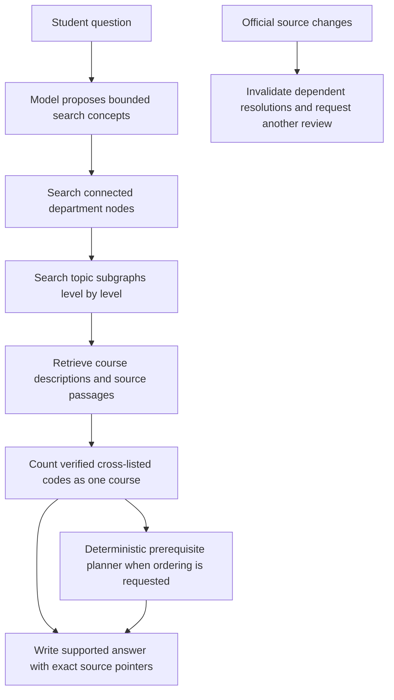

# Repair plan: course identity, graph search, grounded answers, and source review

This plan incorporates the user's decisions from 2026-10-10. It explains intended behavior before implementation details. It is a proposed implementation plan, not a record of completed fixes. The numbered work items correspond to the user's thirteen points. The two database-pool findings are combined under item 7.

The existing audit is indexed in [README.md](README.md). During implementation, accepted behavior and API changes must be reflected in [architecture.md](../architecture.md), which remains the repository's single canonical design contract. Existing instructions that describe containment-only graph serving will need to distinguish the new department/topic routing connections described here. This plan does not authorize course-to-course similarity links.

## What we are building

A student asks about an interest or career. The model turns the request into useful search concepts. Search finds promising departments, then relevant topics within those departments, then course evidence. Officially cross-listed codes represent one underlying course. The model explains a short, supported set of choices.

When the student asks what order to take courses in, the deterministic prerequisite graph supplies the order. A model cannot add or repair prerequisites. An unresolved requirement produces an explanation of what is missing rather than a confident invented sequence.

When official evidence changes, any human review that relied on it becomes due for review again. An earlier successful answer or review never becomes permanent institutional truth.

The drawing supplied by the user is interpreted as large department nodes connected in a main routing graph, with topic subgraphs attached to each department. Topic-to-topic similarity connections are an optional extension to evaluate. Courses remain members of those topic groups, with a separate prerequisite graph for ordering.

## Decisions already made and experiments still needed

| Item | Decision |
| --- | --- |
| Course deletion breaks graph | Remove the dependency that lets a live course deletion erase a saved topic build. |
| Wrong catalog boundaries | Correct the splitter and replace contaminated current sources and program records. |
| Cross-listings | Store explicit cross-list identity in the database and count the underlying course once. |
| Searching raw prompt words | Add a bounded model query-planning step; application code executes the resulting searches. |
| Unsupported claims | Start with a stronger system prompt and measure remaining failures before adding stricter enforcement. |
| SQL failure isolation | Isolate failed statements so other search methods can continue. |
| Database connections | Keep bounded pools, fix connection ownership, and size from actual workload. |
| Provider settings | Give every provider/key profile its own settings box and separate draft state. |
| Credential confusion | The affected credentials are provider API keys/tokens; make the target unmistakable. |
| Citation navigation | Add stable pointers to the exact source and passage, including historical evidence. |
| Major-track sequencing | Broadly check catalog-supported major paths; retain cautious blockers. |
| Graph traversal | Top-down search through connected departments and topic subgraphs. Evaluate optional subgroup cosine links. |
| Changed-source reviews | Invalidate dependent resolved work and require another review. This replaces the earlier point-in-time-only proposal. |

Department routing thresholds, breadth limits, and optional subgroup links remain experiments. Their initial values must be configuration settings supported by comparisons, not hardcoded guesses presented as final design.

## 1. Make a course removable without taking the graph with it

### Why the existing behavior happened

The database gives a cluster a reference to a representative course. That reference is configured to delete the cluster when the course is deleted. Parent/child cluster references then delete descendants. The representative was meant to help describe a group, but the database accidentally treated it as the group's owner.

A course should be removable from the current catalog without deleting saved groups. The audit reproduced the mistake with fake data: removing one course left thirteen courses but no topic clusters.

### Intended behavior

Deleting or retiring a catalog listing changes current catalog membership. It does not erase historical topic builds, their members, labels, vectors, or the evidence explaining an old recommendation.

Every build records the exact catalog source/revision, embedding model, department mapping, cross-list membership revision, clustering settings, and hand-written nudges used to create it. A build is served as current only when those inputs match the published catalog.

### Implementation

1. Add an append-only migration to remove cascading ownership from live course references into graph snapshots. Changing only the representative reference is insufficient: saved members and course-vector rows also currently depend on live course rows.
2. Give the build its own immutable course/member snapshots: stable identity, code aliases, displayed title, department membership, and the vectors used in that build. A live-course pointer can be nullable or informational; deleting its target must not delete the snapshot.
3. Store the representative's identity and descriptive information in that snapshot. A representative disappearing from the current catalog has no ownership effect on a saved cluster.
4. Bind publication and reads to the build's catalog/input revision. A changed catalog cannot silently continue serving yesterday's groups as current.
5. Prepare a replacement catalog and its graph from the same staged data. Validate them before switching the current pointers together in one short transaction. Embedding and clustering happen before that transaction.
6. As an initial containment fix before joint staging exists, retire an incompatible build when the catalog changes and expose “topic graph rebuilding” explicitly. This temporary unavailability is preferable to serving incompatible groups; it is not the final desired publication workflow.

Parser-only requisite updates that leave descriptions, aliases, vectors, and department membership unchanged do not require a topic rebuild. Record separate input fingerprints so a prerequisite parser revision is not mistaken for a topic-content change.

Historical builds already damaged by cascades must be marked unavailable/damaged, not reconstructed from guessed information. Rebuild current recommendations from verified catalog data; recover old snapshots only where authoritative stored evidence supports reconstruction.

**Main files:** [atlas importer](../../backend/app/atlas/importer.py), [graph build](../../backend/app/simgraph/build.py), [graph queries](../../backend/app/db/queries/simgraph.sql), new migration and snapshot queries.

**Acceptance:** Remove a root representative, another representative, and an ordinary member. Historical trees remain readable and unchanged. The new current graph contains exactly the valid current canonical courses. Failed staging leaves the previous compatible catalog/build pair intact. Concurrent publication cannot mix two versions.

## 2. Put department information in the right documents

### Intended behavior

The RWID minor contains its own requirements. Department descriptions appear under their own department identities. A student asking about Judaism should not receive a Jewish Studies passage labelled as an RWID requirement.

### Implementation

- Change the PDF splitter to recognize the transition from program requirements to department sections, including transitions on the same page. Detect document structure, not a hardcoded page number or the word RWID.
- Preserve the department appendix as correctly titled sections instead of discarding useful information.
- Check the entire set of program boundaries, not just the last program. Cover contents-page headings, wrapped headings, adjacent sections, and missing markers.
- Regenerate canonical Markdown, provenance sidecars, the origin manifest, and parsed program requirements. Acquisition dates stay outside canonical content identity.
- Replace affected current sources using the existing staged origin-aware ingestion process. Historical sources and answers retain their original evidence.
- Reopen reviews dependent on changed sources under item 13.

**Main files:** [catalog splitter](../../backend/app/programs/catalog_pdf.py), [program scraper](../../backend/scripts/scrape_programs.py), [program parser/importer](../../backend/app/programs/), [ingestion](../../backend/app/ingest/pipeline.py).

**Acceptance:** Each program has only its own body; departments have correct names and locators; no substantive appendix material disappears. The previously contaminated examples retrieve properly labelled evidence after replacement.

## 3. Store cross-listed courses as one underlying course with several codes

### What we already have

The cached public catalog contains explicit `crossListedCourses` records. A local scan found 3,357 cached course records, of which 876 have a non-empty cross-list field. These are counts of cached listings, not counts of unique underlying courses or a claim about the currently indexed course total.

For example, the cache explicitly links AAS 325 and REL 325, both “Black Love.” It also links AAS 364, AFS 364, and HIST 364. The current conversion to atlas JSONL keeps code/title/description/requisites but drops cross-list metadata. We can retain official relationships instead of guessing from similar wording.

### Proposed identity model

| Record | Meaning |
| --- | --- |
| Canonical course | One underlying course for recommendation counting and graph membership identity. |
| Course listing | Its official department code, title, source locator, credits, and raw requirements. Existing listing/citation identities remain addressable. |
| Cross-list evidence | The official source's explicit relation, external identifiers, effective dates, and source revision. |
| Membership revision | The verified mapping from listings to canonical courses for a particular catalog version. |

Names and descriptions are useful for spotting missing metadata, but they do not prove two courses are cross-listed. Course equivalencies, similarly titled courses, and ordinary/W variants are not automatically cross-listings. The cache's `courseGroupId` can differ between explicitly cross-listed listings; do not assume that field alone is the shared course identity.

### Implementation and behavior

1. Preserve the upstream identifiers and explicit cross-list relations in atlas acquisition and the typed input schema. Resolve referenced external IDs against the same catalog edition. Retain unresolved or contradictory references for review.
2. Build canonical groups from verified relations. Allocate stable content-addressed identities from a retained group anchor/provenance rule; persist merge/split history so removing an alias does not silently change every historical reference.
3. Keep code-to-course mapping available for exact queries, prerequisite references, program requirements, and student-completed codes.
4. Count a canonical course once in an answer. Show useful aliases, for example “AAS 325 / REL 325 — Black Love,” with the actual supporting listing citations.
5. Deduplicate before fusion quotas and answer limits. Additional aliases must not consume the slots needed for distinct courses.
6. Within a department, give a canonical course one clustering contribution even if several aliases belong there. A verified cross-listed course may appear through its official listings in several departments; do not move courses into a different department because vectors are similar. Deduplicate the final global shortlist by canonical identity.
7. Keep raw listing-specific requirements. If aliases disagree about prerequisites, credits, effective dates, or eligibility, expose the conflict and block an unsupported merged sequence. Do not silently pick whichever alias is easiest.
8. Resolve deterministic prerequisite references through verified identity while retaining the written code and its evidence. Completing a verified alias can satisfy the same underlying course only within the verified edition/equivalence policy. Degree applicability and permission to count credit toward multiple requirements still need explicit program evidence.

**Main files:** [catalog acquisition](../../backend/app/atlas/catalog.py), [atlas records](../../backend/app/atlas/records.py), atlas importer, program mentions, advising planner/context, fusion, graph build, new named queries/migration, API types.

**Acceptance:** Exact code search works for every alias; cross-listed courses count once; unrelated duplicate descriptions stay distinct; aliases do not inflate topic vectors. Contradictory metadata is visible and cannot produce false eligibility. Old citations still open after backfill and catalog changes.

## 4. Let the model choose useful search concepts

### Intended behavior

For “What courses help me work on autonomous robots?”, the search should focus on concepts such as robotics, programming, electronics, instrumentation, and control. It should not treat every ordinary word in the question as an equally meaningful database search term.

### A bounded query-planning step

Before retrieval, ask the configured evaluated model for a small typed search plan:

- The student's stated objective, without adding personal interests or completed courses.
- A small list of relevant search concepts and phrases.
- Exact course codes, quoted phrases, numbers, and explicit constraints to preserve.
- Separate search intents, such as course exploration, policy lookup, or requested prerequisite ordering.

The model chooses terms; existing application functions issue parameterized named SQL and semantic searches. It does not receive permission to write arbitrary SQL, expand the student's source/workspace scope, or change graph facts.

Use the original question as semantic context, with the planned concepts as targeted searches. Preserve exact user codes/numbers deterministically even if the model omits them. Combine distinct evidence before canonical-course deduplication and fusion. A concept such as “control” is a search hypothesis, not proof that a course teaches it.

All planning calls use the existing provider factory, evaluated profile/scope policy, deadline, and shared operation budget. Create the logical operation before planning so the planner call is not invisible free work. Account for planning, retrieval expansion, answer generation, and any repair separately within the same limit.

If planning fails, use a documented conservative fallback: semantic search from the original question and exact-code/numeric retrieval, with a warning in the trace. Avoid reinstating broad raw-prompt OR matching as the only fallback. Source IDs `[]`, omitted scope, and private workspace restrictions keep their existing meanings.

Record the plan and evidence selection in the ordinary query trace. That lets us see whether the model chose poor terms, retrieval missed good evidence, or generation misused it without creating extra report files.

**Acceptance:** Robotics and satellite questions search useful concepts without inventing course coverage. Policy questions retain exact policy terms. Plans cannot broaden private data access. A planner outage produces controlled fallback or a clear refusal, with correct usage accounting. Compare against the same frozen questions before promoting this route.

## 5. Start with a stricter system prompt, then add policies where evidence demands them

### First change

Strengthen and version the answer prompt around explicit rules:

- State only what the supplied current passages and authorized deterministic tools establish.
- Explain a course's fit using its actual supplied topics. Label the fit as an inference.
- Do not decode code suffixes, invent credits, claim guaranteed career outcomes, or claim enrollment eligibility without evidence.
- A title from a program list can be named, but missing topic/requirement evidence must be stated clearly. Do not invent a description.
- One supported course is a valid shortlist; do not fill five slots with adjacent subjects.
- When a requested skill is not established by the retrieved evidence, state that limitation. Do not claim the entire catalog lacks it unless a supported exhaustive check establishes that.
- Use deterministic planner results for course ordering and preserve its blockers.
- Attach each citation to the claim it actually supports.

Include short positive and negative examples, including the earlier unsupported ITAL 301W suffix claim. Keep the prompt focused and consistent rather than adding overlapping instructions indefinitely.

### What stricter policies would mean later

If the same failure families remain, add targeted mechanical checks for facts that are represented in structured data: course identity, exact titles, known aliases, numeric credits, and agreement with planner output. A failed check should remove/withhold the unsupported claim or trigger one bounded repair—not invent replacement facts.

Optional model claim review is a later experiment with visible uncertainty and budget accounting. It cannot verify enrollment approval or rewrite prerequisites. Prompt compliance alone is not the acceptance criterion.

**Acceptance:** Repeat the known failures and a held-out set of unrelated questions. Judge whether the answers help the student and whether their statements are supported. Citation-marker validity and HTTP 200 are necessary checks, not sufficient evidence of success.

## 6. Contain a failed SQL statement to its search method

### Intended behavior

If keyword search hits a statement error, embedding search and prerequisite lookup can still produce evidence. The trace says which method failed. A complete database outage still produces a clear service failure; it cannot be solved by pretending another search worked.

### Implementation

- Give SQL-bearing search methods explicit transaction/savepoint boundaries. Roll back the failed method's work before attempting further statements.
- Make transaction ownership clear. Do not roll back unrelated caller work as an incidental retrieval side effect.
- Keep remote embedding outside open database transactions; do not put the whole embedding call inside a savepoint that holds a transaction open.
- Commit a coherent trace after search, including failed/dormant/disabled states. If the database itself is unavailable, use the existing service-error path rather than promising a persisted trace.
- Apply the same policy wherever retrieval is used, including durable conversation execution.

**Acceptance:** Inject a real Postgres statement error into one method in an isolated test DB. Other available methods complete, the connection remains usable, and the trace correctly records the failure. Python-only exception tests do not cover this case.

## 7. Fix connection ownership and scale the pool deliberately

### We do not have a one-connection default

Current code defaults `DB_POOL_MAX_SIZE` to **20 per pool role per process**. The one-slot configuration was a boundary test that exposed a structural mistake. A request can hold one connection while a nested store/ledger asks the same pool for another. With one slot it waits on itself; enough simultaneous requests can exhaust a larger pool too.

### Implementation

1. Use short connection borrows for reads, reservations, ledger transitions, cancellation, and publication. Release the borrow before waiting for model/network work whenever the workflow permits it.
2. For nested transitions, either deliberately pass the transaction-owning connection or release it before the store opens its own transaction. Choose one ownership model per path and preserve cancellation/publication lock ordering.
3. Address both conversation abandonment and synchronous tool queries/conversation turns. A `commit()` ends a transaction but does not return a borrowed connection to its pool.
4. Keep distinct worker roles only where execution/control separation is justified. Document their combined bounds rather than creating an unbounded new pool for every operation.
5. Add bounded wait behavior and an actionable busy response. Observe pool wait time, borrowed count, request concurrency, and provider wait time.
6. Size deployment from total processes and roles: total maximum connections is the sum of each process/role's limit, plus administration headroom. Check it against the deployed database's actual connection limit. Do not increase 20 blindly or disable pooling to hide the defect.

**Acceptance:** One-slot regression tests complete through safe sequential ownership. Concurrent query/cancel tests at realistic pool sizes produce bounded waits, preserve leases/cancellation, and avoid holding all connections while models respond. Measure throughput and wait time, not just an isolated happy-path request.

## 8–9. Give each provider/API key its own settings box and credential state

### What “key” means here

These are API credentials used to call model providers—API keys, or a provider-specific API token. They are unrelated to citations, course codes, or database primary keys. A profile identifies the provider, model, endpoint, roles, and that credential's permissions/settings.

### Intended interface

Each saved connection appears in its own clearly named box. The box owns its settings editor, validation messages, credential replacement form, and save state. Editing one box cannot alter another box's settings or carry its credential draft into another profile.

Show the profile name, provider, model, connection/evaluation status, and whether a credential is configured. Never display the stored credential. Multiple profiles may use the same provider with different models or keys.

Provider identity is fixed on an existing box. To change providers, create a new profile; keep the old one available until the new profile is configured and evaluated. This avoids silently reinterpreting an existing provider's secret/settings. Model or same-provider endpoint changes still advance the profile revision and require the existing evaluation policy.

### Implementation

- Replace shared form/secret drafts with state owned by a profile identity. The create-profile editor has its own draft.
- Render only applicable settings. Construct write DTOs from validated provider-specific fields; do not submit invisible leftovers.
- Keep roles and capabilities compatible with the provider. Decision-only profiles cannot quietly inherit generation roles.
- Label credential actions “Replace API key for [profile]” or “Replace API token for [profile].” Changing/closing the target clears the unsaved secret.
- Keep credentials password-masked and transient, exclude them from logs, browser storage, error text, and returned API DTOs, and retain server encryption.
- Serialize saves for a box, keep failed ordinary settings drafts, and use expected revisions so stale edits cannot overwrite current settings.

**Main files:** [ConnectionSettings](../../frontend/src/components/connection/ConnectionSettings.tsx), [connection components](../../frontend/src/components/connection/), [profile validation](../../backend/app/connections/models.py), connection routes and tests.

**Acceptance:** Edit several profiles independently. No hidden fields cross provider boundaries; opening B's credential editor after A never retains A's text. Stale saves conflict visibly. New profiles route only after the required evaluation passes.

## 10. Give every citation a pointer to the exact document and passage

### Intended behavior

Clicking a citation opens the cited passage from the cited source revision. Two uploads named `requirements.md` remain distinguishable. An old answer opens its historical evidence even after a new catalog is published.

### Implementation

- Carry `sourceId` alongside `chunkId`, source name, and locator in serialized citations and context. Include the source/index revision or immutable evidence snapshot identifier where needed to distinguish reindexing.
- Use stable identities for frontend navigation; filenames remain display labels.
- If the source is still in the current list, highlight that exact row. If it is historical or no longer listed, open the saved evidence view and label its version; never select a similarly named current upload.
- Resolve historical passages from saved response/turn evidence where reindexing changed chunk layout. A historical citation must not resolve to newly changed text merely because an ID was reused.
- Enforce workspace authorization on every evidence lookup. A source pointer is an identity, not permission to access another workspace.
- Update the architecture/API schema/TypeScript contract and both real and mock clients together. Provide compatibility for existing persisted answers that only contain name/chunk references.

**Acceptance:** Same-name uploads, shared plus private sources, retired catalog versions, and reindexed text all open the correct evidence. Unauthorized pointers return a scoped not-found response. Displayed historical text is unchanged.

## 11. Check major paths broadly while preserving honest blockers

### What this review must actually establish

The earlier audit did not inspect every course's prerequisite order or every topic assignment. This work must examine those actual graph facts and resulting student paths. A test reporting success while all useful paths are withheld is not an acceptable result.

### Major-path sweep

1. Enumerate all available official majors, minors, and explicitly documented tracks from the corrected program sources. Verify the program records themselves before using them as expectations.
2. Resolve program course mentions through the current atlas and verified cross-list mapping. List missing/retired codes and conflicting evidence.
3. Check prerequisite/corequisite data for each mentioned course: exact raw source statement, parsed Boolean structure, missing targets, cycles, grade conditions, permission/standing requirements, and citation coverage.
4. Exercise each program's explicit core and documented tracks, plus bounded representative elective alternatives and student-completion scenarios. Do not brute-force every elective combination or invent tracks absent from the source.
5. Validate ordering against the written conditions. Required predecessors must precede dependent courses; corequisites follow their actual rule; alternatives require a valid choice. Cross-listed aliases cannot create duplicate stages or credit counts.
6. Preserve distinctions between “verified dependency order,” “blocked by permission/grade/unknown fact,” “parser cannot yet understand this statement,” and “program logic is not represented yet.” Fix deterministic parser bugs with regressions; unresolved source facts need review.
7. Separately review learned topic groups: courses in the wrong topic, misleading labels, unrelated members, missing expected groups, and wrong fixed department mappings. Topic membership never supplies prerequisite edges.

**Example of cautious correctness:** If the official text says instructor permission is required, the planner should not say the student is eligible. It can show the supported dependency order and explain that permission remains outstanding where the existing planner contract allows a partial result.

A semester/graduation plan additionally requires term offerings, credit/load rules, scheduling restrictions, and program applicability evidence. Until those are available, label results as dependency stages. Do not let plausible-looking sequences imply enrollment approval.

**Acceptance:** Every available program is attempted or has a specific stated exclusion. Track counts attempted/verified/partially supported/blocked, and reasons. Include negative cases that must be blocked. Spot-check raw statements against produced sequences. A blanket refusal rate or generic “tests passed” cannot substitute for coverage.

## 12. Search the graph top down, using relevance at each level

### Three separate kinds of relationship

| Relationship | Purpose |
| --- | --- |
| Department contains topic; topic contains course | Organizes the catalog and preserves fixed department membership. |
| Department/topic similarity connection | Helps search travel between promising areas. It does not declare two courses interchangeable. |
| Prerequisite/corequisite relation | Determines ordering from explicit official facts. It has no cosine score. |

The user has now requested connections in the main department graph. Add that routing layer explicitly instead of pretending it is the existing containment tree. Keep relationship types distinguishable in storage, API responses, and the UI.

### Traversal

Breadth-first search visits nodes level by level. On its own, it does not know which nodes are relevant. We will score candidates against the query embedding at each level, then traverse promising candidates within a bounded breadth. This is a top-down, relevance-ranked breadth-first search.

1. Embed the original question and validated search concepts.
2. Score all department entry nodes; this is a small coarse set. Choose several promising seeds rather than starting at an arbitrary department or only the student's presumed major.
3. Traverse bounded department neighbors in the connected main graph. A connection can expose another department worth scoring; its edge weight is not the same thing as relevance to this particular question. Track visited nodes to avoid loops.
4. Enter selected department subgraphs. Score children at each topic level, keep several promising branches, and continue breadth first within those subgraphs.
5. Retrieve actual course descriptions from selected topic groups and targeted semantic lookup. Count verified canonical courses once in the combined shortlist.
6. If ordering is requested, send the chosen course identities and explicit student assertions to the deterministic prerequisite planner.

Do not turn a low-scoring mixed parent into an absolute veto on all descendants. Preserve a bounded look-ahead allowance or compact topic-vector summaries at department entry, so a small strong topic can still be explored. Record why a branch was explored or pruned. We need a bounded policy that we can evaluate, not an unrestricted scan disguised as BFS.

### Main department connections

Build/query department similarities from department/topic representations, not course pairs across the catalog. Use sparse neighbor connections with configured degree/threshold limits. The root can connect every department structurally; optional department-to-department neighbors provide the routing shown in the user's sketch without requiring every department pair to have a persistent edge.

The authoritative mapping determines which departments exist and which listings belong to them. Similarity never moves a course across a department boundary. Retain verified catalog ownership metadata currently discarded during acquisition where it can improve the fixed mapping; disagreements require a deterministic mapping fix or human review.

### Optional subgroup cosine links

After the baseline traversal works, test a small number of similarity connections between topic/subgroup nodes, including across departments if useful. For example, a statistics topic can expose a nearby data-analysis topic in another department.

Keep these links versioned with the graph build, bounded per topic, clearly typed, and limited to a configured number of routing hops. They never become prerequisites and never create individual course-to-course similarity edges. Cross-list identity is exact catalog metadata, not a similarity connection.

### Compare before promoting

Compare the existing walk, the top-down breadth-first walk, the walk with bounded look-ahead, and the optional topic-link variant on the same interests. An offline full scan of topic centroids can serve as a reference for detecting relevant topics the bounded walk missed; it is a diagnostic baseline, not the proposed bottom-up product flow.

Measure relevant topic discovery, supported distinct-course coverage, wrong-topic inclusions, nodes visited, latency, and duplicate aliases. Include broad careers and small niches in diverse departments. The user's picture supports the intended structure; it does not by itself establish good thresholds.

**Main files:** graph build/walk/view and queries, department configuration, retrieval configuration, graph API types/frontend views, semantic evidence selection.

**Acceptance:** Search traces demonstrate department → topic → course exploration. Connected routing has loop/breadth limits. Relevant small topics remain discoverable. Topic links produce measurable benefit before becoming default. Course ordering comes exclusively from the deterministic graph.

## 13. Rewrite resolution as evidence-dependent approval that expires on change

### New rule

“Resolved” means a human reviewed this question using specific evidence versions. If that evidence changes, the approval is no longer current. The system must ask for another review; it must not wait until another student gets a bad answer.

Example: a reviewer resolves a question about withdrawal deadlines using a policy document. A new policy document replaces it. The queue immediately marks that resolution as needing review, displays the changed source, and preserves the earlier reviewer/note/evidence for history. A successful model answer does not close the review automatically.

### State and evidence model

- Keep `open`, `resolved`, and add `needs_review` with a reason such as source replaced, source removed, source reindexed with changed evidence, or dependent structured facts changed.
- Each resolution has an immutable ID, reviewer, timestamp, note, and evidence dependencies: source ID, logical origin, source/index revision, and relevant chunk/fact fingerprints where available.
- Retain past resolutions. The active gap points to a current valid resolution or a pending review; reopening does not erase historical approvals.
- Bind legacy resolutions to a trustworthy evidence version where possible. Where their reviewed revision cannot be established, mark them for review rather than attaching today's revision and pretending it was reviewed.

### Invalidation

1. Source replacement/reindex publication records dependency changes and invalidates affected active resolutions in the publication transaction, or writes a transactional outbox event consumed idempotently. No change event may be lost between “source updated” and “review reopened.”
2. Track logical origins so a replacement with a new source ID still finds reviews of the old source. Include changed parser/alias facts when a review relies on them even if raw bytes stayed the same.
3. Reindexing identical evidence or reingesting unchanged bytes is a no-op for approval. Where fine-grained dependency matching is not reliable, invalidate conservatively at source level. Do not assert that a changed passage is irrelevant without reliable evidence.
4. Resolution itself checks and locks the expected source revisions consistently. Concurrent source publication cannot leave an approval attached to an unreviewed new version. Use one documented source/gap lock order.
5. A worker reconciliation pass compares current dependency fingerprints against active resolutions to catch delayed events or legacy mismatches. While invalidation is pending, reads must not advertise the resolution as current.

The review queue says what changed, shows old and new evidence identities, and offers explicit review actions. A human reviews the new source, revises the resolution, or returns the question to open because the source no longer answers it. The model may assist with a clearly labelled comparison later; it cannot automatically renew approval or edit prerequisite facts.

Update metrics so `needs_review` is visible as outstanding work rather than a successful resolution. Keep separate counts for missing evidence, changed evidence awaiting review, and repeated answer failures.

**Main files:** [gap store](../../backend/app/gaps/store.py), [gap queries](../../backend/app/db/queries/gaps.sql), source publication/reindex, gap routes, worker reconciliation/outbox where used, API types and [review UI](../../frontend/src/components/gap/GapReviewPanel.tsx), new migrations.

**Acceptance:** Replace a policy, remove a source, change relied-on structured facts, perform a no-op reindex, and race a reviewer with publication. Changed dependencies require another review exactly once; no-op changes do not. Historical review evidence survives. Worker/event retries cannot double-count or silently renew approvals.

## Implementation sequence

### Phase A — Stabilize database behavior and source identity

Implement items 1, 2, 6, 7, and 10, with item 13's dependency invalidation available before changed sources are promoted. This prevents graph loss, poisoned queries, connection self-waits, incorrect labels, and incorrect evidence navigation. Existing failure reproductions become regressions.

First verify the current working tree: this repo has ongoing changes, so recheck that each audited defect remains before editing. Use existing backup/restore verification to stage and test the schema/data repair against a separate database. Never stop or replace the development Postgres process tree as an incidental test action.

### Phase B — Make course identity and provider editing correct

Implement item 3 and items 8–9. Backfill verified cross-lists from the raw cache, preserving unresolved/conflicting references. Rebuild the topic graph using canonical contributions only after source and identity validation. Add profile-specific editor behavior and browser cases.

### Phase C — Improve search and explanation

Implement items 4, 5, and the baseline of item 12. Start with stronger prompts and bounded planning/traversal. Use the frozen broad questions plus held-out cases to decide whether extra claim policies or topic links are needed.

### Phase D — Inspect actual major paths and topic assignments

Perform item 11 across available programs and extend the independent graph-content review. Fix deterministic parser/data errors found by that sweep; preserve justified blockers. Tune traversal using supported course/topic coverage and actual student answers, not HTTP success counts.

These phases can share infrastructure, but dependencies matter: grouping dirty source material or tuning retrieval before correcting it would make the comparison hard to interpret.

## Schema, API, and rollout boundaries

- Use new append-only migrations after the current highest applied migration. The checkout presently has 033; recheck before allocating numbers. Never rewrite the applied baseline or legacy archive.
- Keep schema changes cohesive: graph snapshot ownership/input revision, canonical cross-list identity, and review dependencies/state. Do not create a migration for every individual bug symptom when one compatible change addresses the underlying model.
- Every application SQL statement belongs in a named query block. Provider construction stays behind factories/runtime; database connections stay behind the connection module.
- Extend API schemas, architecture documentation, TypeScript types, real/mock clients, and persisted-evidence compatibility together.
- Stage/backfill in a separate database or controlled staging workflow. Preserve old source/chunk/answer/build/review records. Repeated backfills are idempotent.
- Version retrieval, prompt, graph, and identity behavior. Keep old compatible read paths until newly staged data passes validation. A failed promotion retains the last compatible published state or reports the specific unavailable feature.
- Store ordinary trace/review evidence in existing application records. Print manual diagnostics to the terminal unless saved output is explicitly requested. This requested plan does not create a recurring report-writing workflow.

## How we decide the work is successful

Use three kinds of evidence together:

1. **Structural regressions:** real isolated Postgres cases for deletion, publication, SQL failure, connection pools, and invalidation races; offline provider fakes; API contract checks; browser profile/citation/review workflows.
2. **Graph-content coverage:** actual source-backed major paths, cross-list conflict cases, and manual review of suspicious topic groups. Record why blocked paths are blocked so refusal does not conceal missing implementation.
3. **Real answers:** repeat the earlier frozen questions and add stratified department/career/policy/order questions. Separate tuning cases from held-out cases; keep aliases of the same canonical course in the same fold to avoid making generalization look better than it is. A live run has explicit call/token/time limits and includes query-planning cost.

For a failure, identify the first point where useful information was lost: acquisition/source boundaries, canonical identity, prerequisite parsing, query plan, department/topic routing, evidence retrieval, fusion, or final explanation. Fix the responsible layer and rerun both that case and independent held-out cases.

Completion means the destructive failures are fixed, identity and review semantics match the user's decisions, the graph-content sweep has meaningful coverage, and sampled answers are supported and useful. No test count, broad refusal, or large quantity of Markdown establishes that by itself.
